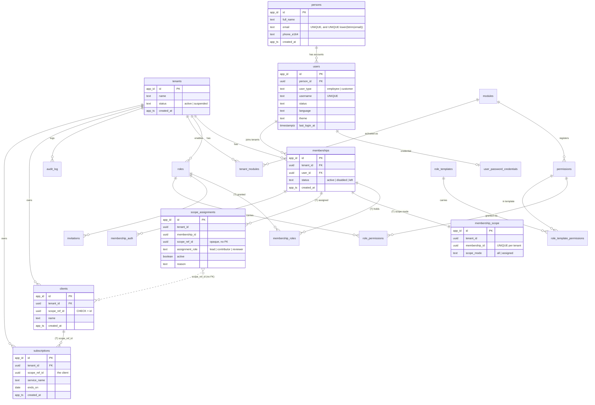

# The Database — a Reference

This document explains the PostgreSQL schema of Platform Core: what each table is for, how tenants are kept apart,
which role may touch what, and how to change the schema without breaking any of it.

It is a reading guide, not the authority. When it disagrees with one of these, they win, in this order:

1. **`src/Migrations/Sql/*.sql`** — the schema itself, applied in order. The only thing that defines the database.
2. **`docs/PLATFORM_CORE_v1_16_FROZEN.md`** (Arabic, authoritative) and its English translation — why each rule exists.
3. **`checks/core/*.json`** — the manifest, the grants matrix and the policy chains the CI checks hold the database to.

**[`docs/schema.sql`](schema.sql)** is the whole schema in one file, generated by `pg_dump` from a database migrated
from clean. Read it when you want to see the final state without replaying nine migrations in your head. Never edit it:
regenerate it (§10). CI fails while it differs from a fresh dump.

> **Snapshot.** Numbers in this document (21 tables, 71 policies, 9 migrations) are as of migration `0009`. The
> catalog is the truth; `docs/schema.sql` is always current because CI enforces it. When you add a migration, update
> the affected sections here in the same PR.

---

## Contents

1. [The big picture](#1-the-big-picture)
2. [The five database roles](#2-the-five-database-roles)
3. [The session variables (the "context")](#3-the-session-variables-the-context)
4. [Isolation: the three layers](#4-isolation-the-three-layers)
5. [Entity–relationship diagram](#5-entityrelationship-diagram)
6. [Table catalog](#6-table-catalog)
7. [Policy patterns](#7-policy-patterns)
8. [The grants matrix](#8-the-grants-matrix)
9. [Keys, timestamps and other schema conventions](#9-keys-timestamps-and-other-schema-conventions)
10. [Changing the schema: the migration workflow](#10-changing-the-schema-the-migration-workflow)
11. [Inspecting the database by hand](#11-inspecting-the-database-by-hand)
12. [Known gaps and open decisions](#12-known-gaps-and-open-decisions)

---

## 1. The big picture

One PostgreSQL 18 database, one schema (`public`) for everything the application uses, and one bookkeeping schema
(`migrations_meta`) that holds only Entity Framework's migration history table.

Every customer of the platform is a **tenant**. All tenants share the same tables; each tenant-owned row carries a
`tenant_id`. Separation is not done by the application remembering to add `WHERE tenant_id = …` — it is done by the
database itself, through Row-Level Security (RLS), privileges and constraints. A bug in a query should produce *zero
rows* or *an error*, never *another tenant's rows*.

Inside a tenant there is a **second axis**: a member either sees all of the tenant's scoped entities (`all`), or only
the ones explicitly assigned to them (`assigned`). In the first module, the scoped entity is the **client**: an
accountant assigned to clients A and B sees A's and B's subscriptions, and nothing about C or D — not even that they
exist.

The tables fall into five groups:

| Group | Tables | Carries `tenant_id`? |
|---|---|---|
| **Identity** (global — one person, many tenants) | `persons`, `users`, `user_password_credentials`, `auth_attempts`, `password_reset_tokens` | No |
| **Tenancy and membership** | `tenants`, `memberships`, `membership_roles`, `membership_auth`, `invitations` | Yes (except `tenants`, whose `id` *is* the tenant) |
| **The second axis** | `membership_scope`, `scope_assignments` | Yes |
| **Modules and permissions** | `modules`, `permissions`, `role_templates`, `role_template_permissions` (global catalogs); `roles`, `role_permissions`, `tenant_modules` (per tenant) | Per tenant ones only |
| **Audit** | `audit_log` | Yes |
| **Module: Subscriptions** | `clients`, `subscriptions` | Yes, and `scope_ref_id` |

---

## 2. The five database roles

The application never connects as a superuser or as the owner. There are five login roles, created once per cluster
by `db/init/00-roles.sh`. **No role is a member of another** (no `GRANT role TO role`), and **only `migrator` has
`BYPASSRLS`**.

| Role | Used by | What it is for | Connection string lives in |
|---|---|---|---|
| `migrator` | The migration tool (`src/Migrations`), the seed script, the catalog checks, ops procedures | Owns every object. Runs migrations. Writes the global catalogs (modules, permissions, role templates). Has `BYPASSRLS` — a documented exception (PLATFORM_CORE §3.4) under three conditions: no application path reaches it; every data migration ends with a row-count check; the alternative (per-tenant migrations) was considered and rejected. | `src/Migrations/appsettings.json` / env. **Never** in Api or Worker — Api refuses to start if it sees it, and CI scans the Api image for the password (T0.3). |
| `app_user` | Api (every normal request), Worker (per-tenant processing) | The application. Everything it reads or writes is filtered by policies using the session variables (§3). | Api, Worker |
| `authenticator` | Api, login only (`Core.Identity.Authenticator`) | Resolves a username + password before any session exists, and writes one `auth_attempts` row per attempt. Since Amendment 01 §2.2 it also writes `password_reset_tokens` (insert, and consumption through `used_at`) — those two tables are its whole write surface. | Api |
| `provisioner` | Api, two paths only: bootstrap (create a tenant) and invitation acceptance | The two paths that legitimately cross isolation: they create rows in a tenant the caller is not (yet) a member of. Each path is one transaction for one tenant, with `app.tenant_id` set to that tenant first. | Api |
| `job_runner` | Worker | Reads the list of **active** tenants to start a background job's fan-out — its only read. The actual work then runs as `app_user`, one tenant per transaction. | Worker |

**Why so many roles?** Each one is a *surface*. If the login code had an injection bug, the attacker would be holding
`authenticator`, which can read credentials and append login attempts — nothing else. Policies for a role only apply
to that role (`TO <role>`), so a policy written for the provisioner can never widen what `app_user` sees.

The roles' passwords in this repository (`docker-compose.yml`, `appsettings*.json`, `scripts/dev-up.sh`) are
development values for local containers. CI generates a fresh `migrator` password on every run.

---

## 3. The session variables (the "context")

Policies cannot know who is asking unless someone tells them. Every transaction sets **custom settings** with
`SET LOCAL` before it touches any table, and every policy reads them with `current_setting(..., true)`.

| Variable | Meaning | Set by | Set when |
|---|---|---|---|
| `app.user_id` | The authenticated user | `UnitOfWork` | Any request with a session |
| `app.tenant_id` | The active tenant | `UnitOfWork`; `ProvisionerUnitOfWork.EnterTenantAsync`; `SystemContext` (jobs) | A tenant is selected (or a provisioner path / job names one) |
| `app.membership_id` | The caller's membership in the active tenant | `ScopeResolver` (step a) | User **and** tenant present |
| `app.scope_all` | `true` if the membership's scope mode is `all` | `ScopeResolver` (step b); `SystemContext` (always `true` for jobs) | User **and** tenant present; or a job |
| `app.can_manage_scope` | The membership holds `core.scope.manage` | `ScopeResolver` (step c); `SystemContext` (always `false`) | Same |
| `app.can_manage_members` | The membership holds `core.members.manage` | `ScopeResolver` (step c); `SystemContext` (always `false`) | Same |

### The order is mandatory

Step **a** reads `memberships` through the `membership_self` policy, which needs only `app.user_id`. Step **b** reads
`membership_scope` through its "own row" branch, which needs `app.membership_id` from step a. Step **c** reads
`membership_roles → role_permissions → permissions`. A single join that tries to do all three at once runs *before*
`app.membership_id` is set, sees zero rows, and the request fails (this was proven: Test 26). So resolution is three
separate reads, each followed by its own `SET LOCAL`.

### The variables are never taken from the client

The second-axis variables come from the database, resolved **on every transaction**. They are never read from a
request body, a header, a query string, a token claim or the session cookie (the cookie holds only `user_id` and the
active `tenant_id`). Check 9 enforces this statically: the strings `app.membership_id`, `app.scope_all`,
`app.can_manage_scope` and `app.can_manage_members` may appear only in `src/Core/Data/ScopeResolver.cs` and
`src/Core/Data/SystemContext.cs` (`checks/core/scope-variable-writers.json`).

Because resolution is per transaction, **revoking an assignment or a permission takes effect on the very next
request** — no logout needed (Test 20).

### Why every policy says `NULLIF(…, '')`

`SET LOCAL` lasts until the end of the transaction. After that, on a *reused pooled connection*, PostgreSQL does not
make the setting disappear — it reverts to the empty string `''`, not to NULL. `''::uuid` would raise an error, and
`''::boolean` too. Wrapping every read as `NULLIF(current_setting('app.x', true), '')` turns "set in a previous
transaction" into NULL, and `tenant_id = NULL` is never true: zero rows. This was the first finding that came from
running code rather than review (PLATFORM_CORE v1.10). Check 2 rejects any policy that reads a setting without it.

The canonical form you will see everywhere:

```sql
tenant_id = (SELECT NULLIF(current_setting('app.tenant_id', true), '')::uuid)
```

The `(SELECT …)` wrapper makes PostgreSQL evaluate the setting once per query (an *InitPlan*) instead of once per row.

---

## 4. Isolation: the three layers

No single mechanism is trusted on its own. Every rule is held by three layers, designed and checked together:

```
policies (RLS)  → which rows a role sees, given its context
grants          → which tables, columns and commands the role may use at all
constraints     → which relationships between rows are legitimate
```

**Layer 1 — Policies.** Every table in `public` has RLS `ENABLE`d **and `FORCE`d** (Checks 1 and 5). `FORCE` means the
policies apply even to the table owner — which is exactly why `migrator` needs `BYPASSRLS` (a data migration with no
tenant context would otherwise silently see nothing). With no context set, every policy for `app_user` evaluates to
false and returns zero rows: the *silent* safety net.

**Layer 2 — Grants.** A policy can only narrow what a grant allows. If `app_user` has no `DELETE` on `audit_log`, no
policy can ever let it delete an audit entry. Column-level grants go further: `app_user` may `UPDATE` only the
`status` column of `memberships`, only `scope_mode` of `membership_scope`, only `active` of `scope_assignments`. Check 6
compares every privilege in the catalog — tables, columns, schema, database, routines, sequences, default privileges,
role memberships — with `checks/core/grants.json`, in both directions.

**Layer 3 — Constraints.** Foreign-key checks run with the owner's privileges and **ignore RLS**. So a plain FK from
`invitations.role_id` to `roles.id` would accept a role from *another* tenant — policies and grants can't see it. The
rule (Check 7): **every FK between two tables that both carry `tenant_id` must be composite and include `tenant_id`.**

```sql
-- parent
ALTER TABLE roles ADD CONSTRAINT roles_tenant_id_id_key UNIQUE (tenant_id, id);
-- child
ALTER TABLE invitations ADD CONSTRAINT invitations_role_fkey
  FOREIGN KEY (tenant_id, role_id) REFERENCES roles (tenant_id, id);
```

Now an invitation in tenant A pointing at a role of tenant B fails with `23503`. An FK toward a *global* table (no
`tenant_id`: `users`, `persons`, `modules`, `permissions`) stays single-column — there is no tenant to keep
consistent.

### "Loud above, silent below"

The database layer fails *silently* (zero rows) — safe, but it hides bugs. So the application adds a *loud* layer on
top: `TransactionRequiredInterceptor` throws if any command runs outside an explicit transaction, `CriticalWrite`
throws when a write affects zero rows where one was expected, and `ScopeResolver` throws when a membership has no
`membership_scope` row. See the developer guide for the application side.

---

## 5. Entity–relationship diagram

Solid lines are foreign keys. Labels ending in **(T)** are composite FKs that include `tenant_id`. The dotted line is
the one *declared gap*: `scope_assignments.scope_ref_id` points at a scoped entity (today a `clients` row) with **no
FK**, until the home of that entity is decided (§12).



---

## 6. Table catalog

For each table: what it holds, its key columns, who can do what, and anything surprising. "Policies" lists policy
names; §7 explains the patterns behind them. `app_user` is abbreviated **app**, `provisioner` **prov**,
`authenticator` **auth**, `job_runner` **jobs**.

### 6.1 Identity — global, no `tenant_id`

A **person** is a physical human. A **user** is a login account belonging to a person. One user can be a member of
many tenants. These tables are global because identity is shared, and login happens before any tenant is chosen.

#### `persons`
| | |
|---|---|
| **Holds** | One row per human: `full_name`, `email`, optional `phone_e164`. |
| **Uniqueness** | `persons_email_key UNIQUE (email)` and `persons_email_normalized_key UNIQUE (lower(btrim(email)))` — one person per address, ignoring case and surrounding spaces (migration 0009; the application compares addresses with the same rule, `Core.EmailAddress.Normalize`). |
| **Policies** | `person_self` (app: your own person), `person_visible_via_membership` (app: people who are members of the active tenant), `persons_provisioner_select` / `persons_provisioner_insert` (prov). |
| **Grants** | app `SELECT`; prov `SELECT, INSERT`. |
| **Notes** | Emails being globally unique means the database can reveal that an address exists. That is a conscious, documented exception (PLATFORM_CORE §3.3); the API hides it with uniform responses (invitations never look a person up). |

#### `users`
| | |
|---|---|
| **Holds** | The login account: `username` (globally unique), `user_type` (`employee`/`customer`), `status`, user preferences `language` and `theme`, `last_login_at`, and `security_stamp` (Amendment 01 §2.1). |
| **FKs** | `person_id → persons(id)`. |
| **Policies** | `user_self_read`, `user_self_update` (app: own row), `user_visible_via_membership` (app: members of the active tenant), `users_authenticator_read` (auth), `users_provisioner_select` / `users_provisioner_insert` (prov). |
| **Grants** | app `SELECT` + `UPDATE (last_login_at, language, theme, security_stamp)` only; auth `SELECT`; prov `SELECT, INSERT`. |
| **Notes** | A user can change their own preferences and their own session stamp, but nothing else about their account. These self-service updates are exempt from auditing (they are not tenant data). `security_stamp` is written by the application on every password change, travels in the session cookie, and is compared with this row on every request — a changed password ends every session (Amendment 01 §2.1; OPEN_ITEMS 36 is closed only in part, because logging out does not change it, and OPEN_ITEMS 52 stays open because the change is not audited). |

#### `user_password_credentials`
| | |
|---|---|
| **Holds** | `password_hash` per user (PBKDF2-HMAC-SHA512, 210,000 iterations; format `pbkdf2-sha512$iterations$salt$hash`), `updated_at`. Primary key = `user_id`. |
| **Policies** | `user_password_credentials_authenticator_read` (auth), `user_password_credentials_provisioner_insert` (prov), `password_self_update` (app: own row). |
| **Grants** | auth `SELECT`; prov `INSERT`; app `UPDATE (password_hash, updated_at)` — **with no `SELECT`**: the application can change a password but can never read a hash back. |
| **Notes** | Never audited. Only the authenticator can read hashes. |

#### `auth_attempts`
| | |
|---|---|
| **Holds** | Every login attempt, success or failure: `username_entered`, `ip_address`, `succeeded`, `created_at`. Append-only. |
| **Policies** | `auth_attempts_authenticator_read`, `auth_attempts_authenticator_insert` (auth). |
| **Grants** | auth `SELECT, INSERT`. Nothing for anyone else. |
| **Retention** | Rows older than 90 days are deleted by `CALL prune_auth_attempts();`, a procedure only `migrator` can execute, scheduled outside the application (`docs/operations.md`). |
| **Notes** | It is its own log, so it is not written to `audit_log`. The limiter of Amendment 01 §5.2 reads it: an escalating delay per (`username_entered` + `ip_address`) and a ceiling per `ip_address`, with no account lockout. Its numbers are Api configuration (`Identity:LoginLimits`) and are settled at launch (OPEN_ITEMS 16). |

#### `password_reset_tokens` (Amendment 01 §2.2)
| | |
|---|---|
| **Holds** | One row per recovery request: `user_id`, `token_hash` (SHA-256 of a 32-byte token — the token itself is never stored), `requested_at`, `expires_at`, `used_at` (NULL until consumed), `request_ip`. Global, no `tenant_id`. |
| **FKs** | `user_id → users(id)`. |
| **Uniqueness** | `password_reset_tokens_token_hash_key UNIQUE (token_hash)` — the lookup path, and no two rows for one hash. |
| **Policies** | `password_reset_tokens_authenticator_select`, `…_insert`, `…_use` (auth). The last is `FOR UPDATE` with `USING (used_at IS NULL)` and `WITH CHECK (used_at IS NOT NULL)`: a token is consumed once, and nothing puts it back. |
| **Grants** | auth `SELECT, INSERT, UPDATE (used_at)`. Nothing for anyone else — no `DELETE` for any application role. |
| **Retention** | Rows older than 90 days are deleted by `CALL prune_password_reset_tokens();`, a `migrator` procedure scheduled outside the application (`docs/operations.md`), like `auth_attempts`. |
| **Notes** | Outside automatic auditing, like `auth_attempts`, and `token_hash` is on the masking list. The row that mints a token (`POST /api/auth/password/forgot`) is **not built yet** — it waits for the e-mail sender (OPEN_ITEMS 53); `POST /api/auth/password/reset` consumes one. |

### 6.2 Tenancy and membership

#### `tenants`
| | |
|---|---|
| **Holds** | One row per customer organization: `name`, `status` (`active`/`suspended`). |
| **Policies** | `tenant_visible_to_member` (app: tenants you have a membership in), `tenants_for_jobs` (jobs: active tenants only), `tenants_provisioner_insert` (prov: only the tenant named by `app.tenant_id`). |
| **Grants** | app `SELECT`; jobs `SELECT`; prov `INSERT`. |
| **Notes** | No tenant can be created through `app_user`. Creation is the bootstrap path only (provisioner), and the bootstrap HTTP route exists only in the Development and CI environments today. |

#### `memberships`
| | |
|---|---|
| **Holds** | The link between a user and a tenant: `tenant_id`, `user_id`, `status` (`active`/`disabled`/`left`). One per user per tenant (`UNIQUE (tenant_id, user_id)`). |
| **Created** | Only by the provisioner — bootstrap (the first owner) or invitation acceptance. Never directly by a tenant admin: joining requires the person's own consent. |
| **Policies** | Reads: `membership_self` (own memberships, needs only `app.user_id` — used by login, tenant selection and resolution step a), `membership_tenant_read` (all memberships of the active tenant). Updates: `membership_tenant_update` (a manager with `can_manage_members` toggles *another* member between `active`/`disabled`), `membership_self_leave` (you set your own `active` → `left`), `membership_lock` (a row lock for the last-owner guards; `WITH CHECK (false)` so it can never write). Provisioner: `memberships_provisioner_select`, `_insert`, `_rejoin` (`left` → `active` when a former member accepts a new invitation). |
| **Grants** | app `SELECT` + `UPDATE (status)`; prov `SELECT, INSERT, UPDATE (status)`. |
| **Parent of** | Composite `UNIQUE (tenant_id, id)` — the target of the composite FKs from `membership_roles`, `membership_scope`, `scope_assignments`, `membership_auth`. |
| **Notes** | No one can disable or remove themselves except by leaving; no one can change their own row through the manager policy (`id <> app.membership_id`). The application additionally refuses any change that would leave a tenant with no active owner or no active `all` member (`LastMemberGuards`). |

#### `membership_roles`
| | |
|---|---|
| **Holds** | Which roles a membership holds (many-to-many). |
| **FKs** | `(tenant_id, membership_id) → memberships`, `(tenant_id, role_id) → roles` — both composite. |
| **Policies** | `tenant_isolation` (app, the standard template); restrictive `membership_roles_manage_insert` / `_delete` (app: only with `can_manage_members`, never on your own membership); provisioner `_insert`, and `_select` / `_delete` limited to memberships that have `left` (clearing old roles on return). |
| **Grants** | app `SELECT, INSERT, DELETE`; prov `SELECT, INSERT, DELETE`. No `UPDATE`: a role is removed and another added. |

#### `membership_auth`
| | |
|---|---|
| **Holds** | Which login provider a membership accepts: `provider` (`password` today; `entra`/`google` later) and `provider_config` (jsonb, empty for password). |
| **Why on the membership** | A tenant may later require its own SSO. Binding the provider to the membership (not the user) means the same person can log into tenant A with a password and tenant B with Entra. Selecting a tenant whose provider the session didn't use returns `step_up_required`. |
| **Policies** | `membership_auth_self_read` (app: your own), `membership_auth_authenticator_read` (auth — currently unused, OPEN_ITEMS 14), `membership_auth_provisioner_insert` (prov). |
| **Grants** | app `SELECT`; auth `SELECT`; prov `INSERT`. |

#### `invitations`
| | |
|---|---|
| **Holds** | A pending offer of membership: `email`, `role_id`, `intended_scope_mode`, `token_hash` (SHA-256 of the random token — the token itself is never stored), `status` (`pending`/`accepted`/`revoked`/`expired`), `invited_by`, `expires_at` (7 days). |
| **FKs** | `(tenant_id, role_id) → roles` — composite, so an invitation can't carry another tenant's role. |
| **Policies** | `invitations_tenant_read` (app); `invitations_insert` (app: needs `can_manage_members`, `invited_by` must be you, status must be `pending`, and an `all` invitation additionally needs `can_manage_scope`); `invitations_tenant_update` (app: only `pending` → `revoked`); `invitations_provisioner_select` / `_update` (acceptance). |
| **Grants** | app `SELECT, INSERT` + `UPDATE (status)`; prov `SELECT` + `UPDATE (status)`. |
| **Notes** | An invitation creates nothing until accepted. Acceptance is single-use: the update is `WHERE status = 'pending'` (an EF concurrency token), so two concurrent acceptances can't both succeed. The invitee's email must match (normalized). `token_hash` is masked in the audit log. |

### 6.3 The second axis

#### `membership_scope`
| | |
|---|---|
| **Holds** | Exactly one row per membership: `scope_mode` = `all` or `assigned`. |
| **Why a separate table** | Not a column on `memberships`, because the column grant for `scope_mode` would clash with the self-leave policy on `memberships` (PLATFORM_CORE §3.8). |
| **Invariant** | Created in the same transaction as the membership. A missing row is an **error** (`membership_scope_missing`, HTTP 500), never treated as a default. Enforcement of "no membership without a scope row" in the database itself is an open item (OPEN_ITEMS 39). |
| **Policies** | `membership_scope_read` (app: your own row, or all rows if you `can_manage_scope`); `membership_scope_admin_update` (app: needs `can_manage_scope`, never your own row); provisioner `_insert`, `_select` and `_rejoin` (only for memberships that `left`). |
| **Grants** | app `SELECT` + `UPDATE (scope_mode)`; prov `SELECT, INSERT, UPDATE (scope_mode)`. |
| **Notes** | Scope mode is a property of the membership, **independent of the role**. An `operator` can be `all`; an `admin` can be `assigned`. Managing scope is a *permission* (`core.scope.manage`), also independent of the mode. |

#### `scope_assignments`
| | |
|---|---|
| **Holds** | One permanent row per (membership, scoped entity): `scope_ref_id`, `assignment_role` (`lead`/`contributor`/`reviewer`), `active`, `reason`. `UNIQUE (tenant_id, membership_id, scope_ref_id)` — also the index `client_scope` reads through. |
| **FKs** | `(tenant_id, membership_id) → memberships` — composite: the assignee is guaranteed to be a member of this tenant. **`scope_ref_id` has no FK** (§12). |
| **Policies** | `scope_assignment_read` (app: your own, or all if you `can_manage_scope`), `scope_assignment_insert` / `_update` (app: `can_manage_scope`); `scope_assignments_provisioner_select` / `_disable` (prov: deactivate the assignments of a returning member). |
| **Grants** | app `SELECT, INSERT` + `UPDATE (active)`; prov `SELECT` + `UPDATE (active)`. **No `DELETE` for anyone**: an assignment is history — it is disabled and re-enabled, never erased. |
| **Notes** | This table carries `scope_ref_id` but must **not** have `client_scope` — the `client_scope` policy reads this table, so a `client_scope` here would recurse infinitely (`42P17`). Check 8 enforces both directions. Who granted or revoked an assignment, and when, is in `audit_log`. |

### 6.4 Modules, permissions and roles

#### `modules` (global catalog)
Registered modules: `code` (`core`, `subscriptions`), `name_ar`, `name_en`, `icon`, `display_order`, `is_active`.
Written only by migrations. app/prov: `SELECT` via `modules_read`.

#### `permissions` (global catalog)
Atomic permissions registered by modules: `module_id`, `code`, `name_ar`, `name_en`. Written only by migrations.
app/prov: `SELECT` via `permissions_read`. Current codes:

| Code | Module | Meaning | Template roles that get it |
|---|---|---|---|
| `core.scope.manage` | core | Change members' scope modes and assignments | owner, admin |
| `core.members.manage` | core | Invite, revoke invitations, enable/disable members, add/remove their roles | owner, admin |
| `core.audit.read` | core | Read the tenant's audit log | owner, admin, operator, viewer |
| `subscriptions.read` | subscriptions | List clients and subscriptions | owner, admin, operator, viewer |
| `subscriptions.write` | subscriptions | Create subscriptions | owner, admin, operator |

#### `role_templates`, `role_template_permissions` (global catalogs)
The base roles every new tenant receives: `owner`, `admin`, `operator`, `viewer`, with their permissions. Read only by
`provisioner` (bootstrap copies them into the new tenant). When a migration adds a permission to a template, it also
upgrades the existing tenants' system roles from the template in the same migration — one source of truth (see
`0007_members.sql`, `0008_subscriptions.sql`).

#### `roles` (per tenant)
A tenant's roles: the four system copies (`is_system = true`) plus any custom roles. `UNIQUE (tenant_id, id)` is the
target of composite FKs.

- `tenant_isolation` (app, standard template) for normal access.
- Three **restrictive** guards for app: `system_role_guard_update`, `_delete`, `_insert` — no editing or deleting a
  system role, no promoting a role to system, no inserting one flagged as system.
- prov: `roles_provisioner_select`, `roles_provisioner_insert` (system roles only, during bootstrap).
- Grants: app `SELECT, INSERT, UPDATE, DELETE`; prov `SELECT, INSERT`.

#### `role_permissions` (per tenant)
Which permissions a tenant's role carries. FKs: `(tenant_id, role_id) → roles` (composite), `permission_id →
permissions`. Policies: `tenant_isolation` (app), `role_permissions_provisioner_insert`. Grants: app `SELECT, INSERT,
DELETE`; prov `INSERT`.

#### `tenant_modules` (per tenant)
Which modules a tenant has enabled. `UNIQUE (tenant_id, module_id)`. Policies: `tenant_isolation` (app),
`tenant_modules_provisioner_insert`. Grants: app `SELECT` + `UPDATE (is_active)`; prov `INSERT`.
**Today no tenant has a row here and no endpoint checks it** — activation per tenant is not enforced yet (OPEN_ITEMS 25).

### 6.5 Audit

#### `audit_log`
| | |
|---|---|
| **Holds** | One row per tracked write: `actor_id`, `actor_type` (`user`, `provisioner`, `job`, `system`), `action` (`insert`/`update`/`delete`, or a job's own action name), `entity_type` (the table), `entity_id`, `old_value` / `new_value` (jsonb), `ip_address`, `created_at`. |
| **Written** | Automatically, in the same transaction as the change, by `AutomaticAuditInterceptor` (EF). Rolled back with it. |
| **Policies** | `audit_log_insert` (app: only into the active tenant), `audit_log_provisioner_insert` (prov: only into `app.tenant_id`), `audit_read` (app: active tenant **and** `scope_all` only). |
| **Grants** | app `SELECT, INSERT`; prov `INSERT`. **No `UPDATE` or `DELETE` for any application role**: append-only (Test 12). |
| **Notes** | An `assigned` member cannot read the audit log at all today (reading it per entity is a later decision). The API also requires `core.audit.read`. `password_hash` and `token_hash` appear as `"[masked]"`. Bulk EF commands (`ExecuteUpdate`/`ExecuteDelete`) would bypass the interceptor, so they are forbidden in `src/` (`check-no-bulk-writes`). |

### 6.6 Module: Subscriptions (`0008_subscriptions.sql`)

The first module, owned by `Modules.Subscriptions`. It shows the full pattern a scoped module follows.

#### `clients`
| | |
|---|---|
| **Holds** | A tenant's clients: `name`. A client **is its own scoped entity**: `scope_ref_id` always equals `id`, held by `CHECK (scope_ref_id = id)`. (A generated column was not allowed — §9 — so the application writes the same value twice.) |
| **Keys** | `UNIQUE (tenant_id, id)`; FK `tenant_id → tenants`; index `(tenant_id, scope_ref_id)`. |
| **Policies** | `tenant_isolation` (permissive) + `client_scope` (restrictive) — both standard templates. |
| **Grants** | app `SELECT, INSERT, UPDATE, DELETE`. Nothing for any other role. |

#### `subscriptions`
| | |
|---|---|
| **Holds** | `service_name`, `ends_on` (date), and `scope_ref_id` — the client it belongs to. |
| **Keys** | FK `(tenant_id, scope_ref_id) → clients (tenant_id, id)` — composite: a subscription can't point at another tenant's client (Test 21). FK `tenant_id → tenants`; index `(tenant_id, scope_ref_id)`. |
| **Policies** | `tenant_isolation` + `client_scope`. Creating a subscription for a client you are not assigned to fails `client_scope`'s `WITH CHECK` (`42501`). |
| **Grants** | app `SELECT, INSERT, UPDATE, DELETE`. |

---

## 7. Policy patterns

All 71 policies follow a small number of shapes. Once you recognize them, the schema reads quickly.

### 7.1 Permissive vs restrictive — the one thing to get right

PostgreSQL combines policies for the same command and role like this:

```
visible = (any PERMISSIVE policy passes)  AND  (every RESTRICTIVE policy passes)
```

So **adding a permissive policy widens access; adding a restrictive one narrows it.** If you want to add a condition
("…and only assigned clients"), it must be `AS RESTRICTIVE`. A second ordinary policy would be OR-ed in and *open*
access instead. Every policy names its command (`FOR …`) and its role (`TO …`) explicitly: a policy without `TO`
applies to `PUBLIC` (Check 4 rejects it).

### 7.2 Template 1 — `tenant_isolation` (every module table)

```sql
CREATE POLICY tenant_isolation ON <table>
  FOR ALL TO app_user
  USING      (tenant_id = (SELECT NULLIF(current_setting('app.tenant_id', true), '')::uuid))
  WITH CHECK (tenant_id = (SELECT NULLIF(current_setting('app.tenant_id', true), '')::uuid));
```

`USING` filters what you can see/update/delete; `WITH CHECK` validates what you write. Both are required so you can't
insert a row into another tenant or move a row out of yours.

### 7.3 Template 2 — `client_scope` (every table with `scope_ref_id`, except `scope_assignments`)

```sql
CREATE POLICY client_scope ON <table>
  AS RESTRICTIVE FOR ALL TO app_user
  USING (
    COALESCE((SELECT NULLIF(current_setting('app.scope_all', true), '')::boolean), false)
    OR EXISTS (
      SELECT 1 FROM scope_assignments sa
      WHERE sa.tenant_id     = <table>.tenant_id
        AND sa.scope_ref_id  = <table>.scope_ref_id
        AND sa.membership_id = (SELECT NULLIF(current_setting('app.membership_id', true), '')::uuid)
        AND sa.active))
  WITH CHECK ( …the same expression… );
```

In words: "you see this row if your scope is `all`, or if you have an active assignment to its scoped entity." With
no context, `COALESCE(NULL, false)` is false and the assignment lookup matches nothing — zero rows. Check 8 requires
this policy on every table with a `scope_ref_id` column and compares its text with the template.

### 7.4 Self-visibility (identity tables)

`membership_self`, `user_self_read`, `person_self`, `membership_auth_self_read`: "the rows that belong to
`app.user_id`". They work **without an active tenant**, which is what lets login, `/me` and tenant selection run.

### 7.5 Visibility through membership (reading other people)

`user_visible_via_membership`, `person_visible_via_membership`, `tenant_visible_to_member`: you can see a user or a
person only if they have a membership in your active tenant. This closes a PII leak: identity tables are global, so
without this every member would see every person on the platform. These policies read another table through
`EXISTS (…)` — a **policy chain**. Every chain is declared in `checks/core/policy-chains.json`, and Check 10 verifies
(via `pg_depend`) that a policy reads only declared tables and that each inner table has a read policy covering the
same role. No view and no non-system function may appear inside a policy expression, because `pg_depend` cannot see
what they read.

### 7.6 Permission-gated writes

`invitations_insert`, `membership_tenant_update`, `membership_scope_admin_update`, `scope_assignment_*`,
`membership_roles_manage_*` test `app.can_manage_members` or `app.can_manage_scope`. The application checks the same
permission first and refuses before sending anything (loud); the policy holds on its own if that check is bypassed.

### 7.7 State-transition policies

Several update policies constrain both the **before** (`USING`) and the **after** (`WITH CHECK`):

| Policy | Allowed transition |
|---|---|
| `membership_self_leave` | own membership: `active` → `left` |
| `membership_tenant_update` | another member's membership: between `active` and `disabled` |
| `invitations_tenant_update` | `pending` → `revoked` |
| `memberships_provisioner_rejoin` | `left` → `active` |
| `scope_assignments_provisioner_disable` | of a member who left: → `active = false` |

### 7.8 The provisioner's policies

Every `*_provisioner_*` policy is `TO provisioner` and, for tenant tables, conditioned on
`tenant_id = app.tenant_id`. The provisioner sets `app.tenant_id` to its one target tenant before its first read, so
even this privileged role works inside one tenant per transaction.

### 7.9 Fail-safe summary

| Context missing | Result for `app_user` |
|---|---|
| No `app.tenant_id` | Zero rows on every tenant table |
| `app.tenant_id` but no `app.membership_id` / `app.scope_all` | Zero rows on every scoped table |
| Variables left over from a previous transaction on the pooled connection | Same as missing (`NULLIF`) |
| Any command outside a transaction | Exception in the application, before the database (interceptor) |

---

## 8. The grants matrix

Table-level grants (from the catalog). `—` means no privilege at all: the role cannot touch the table whatever the
policies say. Column lists in parentheses are column-level `UPDATE` grants.

| Table | app_user | provisioner | authenticator | job_runner |
|---|---|---|---|---|
| `tenants` | SELECT | INSERT | — | SELECT |
| `persons` | SELECT | SELECT, INSERT | — | — |
| `users` | SELECT, UPDATE (last_login_at, language, theme, security_stamp) | SELECT, INSERT | SELECT | — |
| `user_password_credentials` | UPDATE (password_hash, updated_at) — **no SELECT** | INSERT | SELECT | — |
| `auth_attempts` | — | — | SELECT, INSERT | — |
| `password_reset_tokens` | — | — | SELECT, INSERT, UPDATE (used_at) | — |
| `memberships` | SELECT, UPDATE (status) | SELECT, INSERT, UPDATE (status) | — | — |
| `membership_roles` | SELECT, INSERT, DELETE | SELECT, INSERT, DELETE | — | — |
| `membership_auth` | SELECT | INSERT | SELECT | — |
| `membership_scope` | SELECT, UPDATE (scope_mode) | SELECT, INSERT, UPDATE (scope_mode) | — | — |
| `scope_assignments` | SELECT, INSERT, UPDATE (active) | SELECT, UPDATE (active) | — | — |
| `invitations` | SELECT, INSERT, UPDATE (status) | SELECT, UPDATE (status) | — | — |
| `modules` | SELECT | SELECT | — | — |
| `permissions` | SELECT | SELECT | — | — |
| `role_templates` | — | SELECT | — | — |
| `role_template_permissions` | — | SELECT | — | — |
| `roles` | SELECT, INSERT, UPDATE, DELETE | SELECT, INSERT | — | — |
| `role_permissions` | SELECT, INSERT, DELETE | INSERT | — | — |
| `tenant_modules` | SELECT, UPDATE (is_active) | INSERT | — | — |
| `audit_log` | SELECT, INSERT | INSERT | — | — |
| `clients` | SELECT, INSERT, UPDATE, DELETE | — | — | — |
| `subscriptions` | SELECT, INSERT, UPDATE, DELETE | — | — | — |

**Database and schema.** Nothing is granted through `PUBLIC`. `CONNECT` on the database goes to the four application
roles; `TEMP` to none; `USAGE` on schema `public` to the four; `CREATE` on it to none. `prune_auth_attempts()` and
`prune_password_reset_tokens()` are executable by `migrator` alone.

The authoritative statement is `checks/core/grants.json`; Check 6 fails on any difference, in either direction.

---

## 9. Keys, timestamps and other schema conventions

| Rule | Why |
|---|---|
| **Keys are `uuid` v7, generated by the application** (`Guid.CreateVersion7()`), written explicitly in every `INSERT`. | Time-ordered keys keep composite indexes on `(tenant_id, id)` local. Generating in the app means no `RETURNING`, which some RLS/EF combinations break. |
| **No `DEFAULT`, identity or generated column anywhere in `public`.** Every EF property is `ValueGenerated.Never`. | A forgotten value must fail loudly, not be filled silently (Test 28). |
| **Domains**: every primary-key column is `app_id` (`uuid`, not the all-zero uuid); every `timestamptz NOT NULL` is `app_ts` (≥ 2000-01-01). `NOT NULL` lives on the column, not the domain. | A forgotten key (`Guid.Empty`) or timestamp (`DateTime.MinValue`) fails with `23514` instead of being stored. |
| **Every index starts with `tenant_id`.** | Policies always filter by tenant first. |
| **Every tenant table carries `tenant_id`** — even child tables whose parent already has it. | The composite FK needs it, and so do the policies. |
| **`CHECK` constraints list allowed values** (`status IN (…)`). | Enum-like columns stay plain `text`, constrained in the constraints layer. |
| **Seed data migrations end with a row-count check** (`DO $$ … RAISE EXCEPTION …`). | Condition 2 of `migrator`'s `BYPASSRLS` exception. |
| **Migrations are forward-only.** `Down()` throws. | A data migration is never "undone" by dropping what it created. Fix forward with a new migration. |

---

## 10. Changing the schema: the migration workflow

The schema is written as **SQL files**, not generated from the EF model. EF Core is used only to run them in order
and record which ran (`migrations_meta.__EFMigrationsHistory`). The EF model (`CoreDbContext`, module contexts) is a
*mapping* to the SQL tables; it never drives the schema.

### Adding a migration

1. **Write the SQL** as the next file: `src/Migrations/Sql/0010_<what>.sql`. Start with a header comment naming the
   task and the PLATFORM_CORE section it implements. Put all four layers for a new table in the same file: table,
   constraints, `ENABLE` + `FORCE` RLS, policies, grants.
2. **Add the class** `src/Migrations/Migrations/M0010_<What>.cs`:
   ```csharp
   using Core;
   using Microsoft.EntityFrameworkCore.Infrastructure;
   using Microsoft.EntityFrameworkCore.Migrations;

   namespace Migrations.Migrations;

   [DbContext(typeof(CoreDbContext))]
   [Migration("20261020000010_What")]   // a timestamp later than every existing one
   public sealed class M0010_What() : SqlFileMigration("0010_what.sql");
   ```
   The SQL files are embedded resources of the `Migrations` project (`<EmbeddedResource Include="Sql\*.sql" />` in
   `Migrations.csproj`), so a new file is picked up with no project change. `SqlFileMigration` finds it by file
   name and throws at migration time if it is missing. Module tables are migrated by this same project — there is
   one migration history for the whole database.
3. **Update the check inputs** if you added or changed a policy, a grant or a chain:
   `checks/core/grants.json`, `checks/core/policy-chains.json`, and (for core tables) the manifest — which is
   *extracted from PLATFORM_CORE and its amendments*, not hand-edited (`checks/core/generate-manifest.py`;
   `check-manifest-extraction` fails otherwise). A policy an amendment states enters the manifest when the PR that
   creates it lists it as `table.policy` in `checks/core/amendment-policies-built.json` and regenerates the manifest;
   until then it is pending. Changing these is changing what the governing document says: it is a project-owner
   decision, raised in the PR.
4. **Migrate a clean database** and run the checks:
   ```bash
   scripts/dev-down.sh && scripts/dev-up.sh          # recreates the database and migrates it
   PSQL='docker exec -i platform-core-dev-postgres psql -U migrator -d platform' checks/core/run-checks.sh
   ```
5. **Regenerate `docs/schema.sql`** and commit it with the migration:
   ```bash
   PG_DUMP='docker exec -i -e PGTZ=UTC platform-core-dev-postgres pg_dump -U migrator -d platform' scripts/dump-schema.sh
   ```
   (In CI, and with the `docker compose` database, plain `scripts/dump-schema.sh` works.)
6. **Update this document** where the change shows: the catalog (§6), the grants matrix (§8), the ERD (§5).

CI then migrates a fresh PostgreSQL 18 container as `migrator`, runs Checks 1–10 and the local checks (including
`check-schema-dump`, which fails if you forgot step 5), each check's self-test, and the full test suites.

### Adding a scoped module table — the checklist

- [ ] `id app_id PRIMARY KEY`, `tenant_id uuid NOT NULL`, timestamps `app_ts NOT NULL`, no `DEFAULT`.
- [ ] If its rows belong to a scoped entity: `scope_ref_id uuid NOT NULL` — the column name the template reads.
- [ ] `UNIQUE (tenant_id, id)` if anything will reference it.
- [ ] FK `tenant_id → tenants (id)`; every FK to another tenant table composite on `tenant_id`.
- [ ] Indexes start with `tenant_id`.
- [ ] `ENABLE` and `FORCE ROW LEVEL SECURITY`.
- [ ] `tenant_isolation` — Template 1, verbatim.
- [ ] `client_scope` — Template 2, verbatim, if the table has `scope_ref_id`.
- [ ] Grants to `app_user` only (normally `SELECT, INSERT, UPDATE, DELETE`), mirrored in `grants.json`.
- [ ] Permissions for the module inserted into `permissions`, added to templates, existing system roles upgraded,
      followed by a row-count check.

### Changing data in a migration

`migrator` bypasses RLS, so a data migration sees and changes **every tenant's rows**. Be explicit about which rows,
and end with a `DO $$ … $$` block that raises an exception if the affected counts are not what you expect. See
`0005_seed_and_retention.sql` and `0008_subscriptions.sql` for the pattern.

---

## 11. Inspecting the database by hand

Connect as a role and set its context to see exactly what the application sees. Inside a transaction, because
`SET LOCAL` outside one does nothing:

```sql
-- as app_user
BEGIN;
SET LOCAL app.user_id   = '<user uuid>';
SET LOCAL app.tenant_id = '<tenant uuid>';
-- what ScopeResolver would set:
SET LOCAL app.membership_id      = '<membership uuid>';
SET LOCAL app.scope_all          = 'false';
SET LOCAL app.can_manage_scope   = 'false';
SET LOCAL app.can_manage_members = 'false';
SELECT * FROM subscriptions;      -- only the assigned clients' subscriptions
ROLLBACK;
```

Useful catalog queries (as `migrator`):

```sql
-- every policy on a table
SELECT policyname, cmd, roles, permissive, qual, with_check
FROM pg_policies WHERE tablename = 'memberships';

-- RLS state of every table
SELECT relname, relrowsecurity, relforcerowsecurity
FROM pg_class WHERE relnamespace = 'public'::regnamespace AND relkind = 'r';

-- every grant to application roles
SELECT table_name, grantee, privilege_type
FROM information_schema.role_table_grants
WHERE table_schema = 'public' AND grantee <> 'migrator' ORDER BY 1, 2;
```

The seed contract (`tests/seed/seed-contract.sql`, run by `scripts/dev-up.sh`) gives you known data: tenants
`Al-Amin`, `Maan` and `Suspended`; users `omar`, `sara`, `khaled`, `layla`, `rami`, `nour` (password
`<username>-seed-password` — test values only). For example `khaled` is an `operator` in Al-Amin, `assigned` to
clients A and B: log in as him and the subscriptions list shows 10 of Al-Amin's 20.

---

## 12. Known gaps and open decisions

These are deliberate and tracked. Do not "fix" them in passing — each needs a decision.

| Gap | Effect | Where tracked |
|---|---|---|
| `scope_assignments.scope_ref_id` has **no FK** | The second axis is protected by two layers (policies, grants), not three, at the entity end. An assignment can point at an id that is not a client. | PLATFORM_CORE §3.3, §9 — the home of the scoped entity (core, module, or a `scopable_entities` registry) must be decided **before the second module**. |
| `client_scope` performance | The T8 measurement exceeded its pre-set threshold (median 1.574× vs 1.5× at p95; ≈ 3.5 ms absolute). | OPEN_ITEMS 27: a materialized assignment table, or a `SECURITY DEFINER` function for `client_scope` — or measure on a dedicated host first. `SECURITY DEFINER` is currently forbidden everywhere. |
| No database guarantee of "membership ⇒ scope row" | Enforced by code paths and a loud error, not by a constraint. | OPEN_ITEMS 39 |
| `tenant_modules` not enforced | A tenant can use a module it has not activated. | OPEN_ITEMS 25 |
| `assigned` members cannot read `audit_log` | `audit_read` requires `scope_all`. | Deferred until a real user needs per-entity history. |
| `membership_auth_authenticator_read` unused | A policy and grant with no consumer. | OPEN_ITEMS 14 (for the next document version). |
| Login attempt limiting | Built (Amendment 01 §5.2): an escalating delay per (username + ip) and a ceiling per ip, no lockout. The deployed numbers are still open, and the dev/CI numbers are deliberately lenient. | OPEN_ITEMS 16, 54 |
| No audit trail for a password change | `user_password_credentials`, `users.security_stamp` and `password_reset_tokens` are all outside automatic auditing. | OPEN_ITEMS 52 |
| `POST /api/auth/password/forgot` is not built | A token can be consumed but nothing mints one: the path needs an address, and `authenticator` has no read on `persons`. | OPEN_ITEMS 53 |
