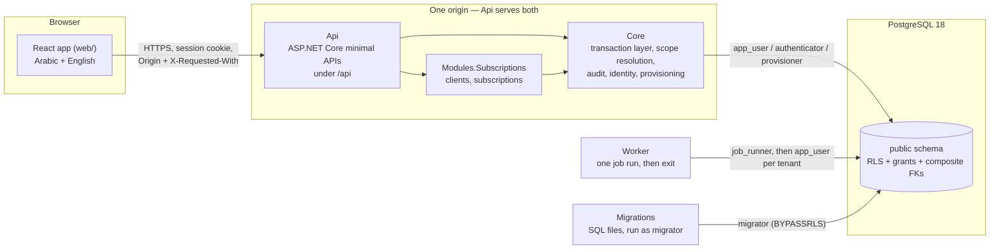
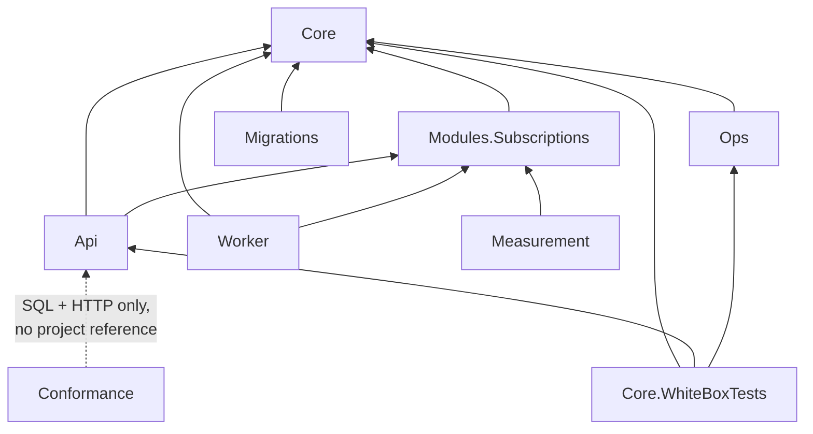
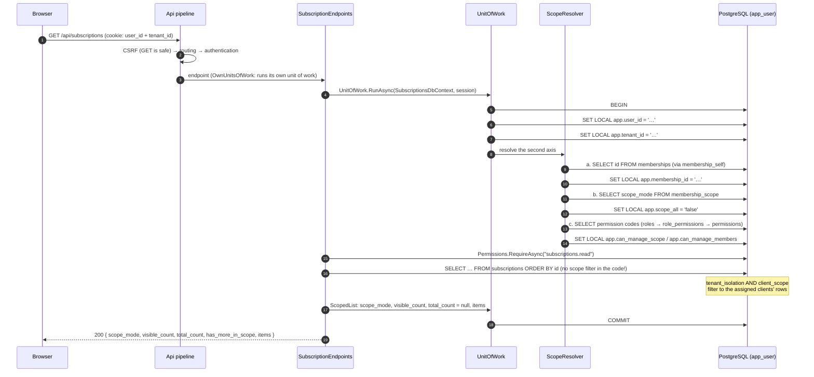
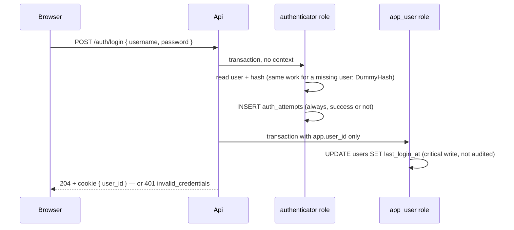

# Platform Core — Developer Guide

Welcome. This guide is for a developer joining the project: it explains what the platform is, how the code is
organized, how a request travels from the browser to a PostgreSQL row and back, and how to add a feature, a table, a
module or a background job **without breaking tenant isolation**.

Read it once end to end before your first change. Keep it open while you work; most sections end with "the rule" —
the short version to remember.

**Companion documents**

| Document | What it gives you |
|---|---|
| [`docs/DATABASE.md`](DATABASE.md) | Every table, policy and grant; the ERD; the migration workflow |
| [`docs/schema.sql`](schema.sql) | The whole schema in one generated file (`pg_dump` of a freshly migrated database) |
| `docs/PLATFORM_CORE_v1_16_FROZEN.md` (Arabic, authoritative) and `_EN.md` | The architecture and *why* — every decision and its rejected alternative |
| `docs/PROOF_SPEC_v1_3.md` (Arabic, authoritative) and `_EN.md` | The tasks T0–T8 and the acceptance criteria every implementation is measured against |
| `OPEN_ITEMS.md` | Everything known to be unfinished, numbered and stable |
| `checks/core/README.md`, `checks/local/README.md` | The CI checks |
| `web/README.md`, `web/GLOSSARY.md` | The React interface |
| `docs/operations.md` | Procedures that run outside the application; the test server's runbook |
| `CLAUDE.md` | The rules in short, read automatically by Claude Code at the start of every session |
| `.github/pull_request_template.md` | The PR checklist (§18), shown on every pull request |

When this guide and the code disagree, the code is right and this guide has a bug — fix it in your PR. When the code
and PLATFORM_CORE disagree, **the document governs**: stop and raise it (PROOF_SPEC rule 8).

---

## Contents

1. [Platform Core in five minutes](#1-platform-core-in-five-minutes)
2. [Vocabulary](#2-vocabulary)
3. [A tour of the repository](#3-a-tour-of-the-repository)
4. [Running it on your machine](#4-running-it-on-your-machine)
5. [How a request works](#5-how-a-request-works)
6. [The data-access layer, piece by piece](#6-the-data-access-layer-piece-by-piece)
7. [Identity, login and the session](#7-identity-login-and-the-session)
8. [Authorization: roles, permissions and scope](#8-authorization-roles-permissions-and-scope)
9. [Provisioning: creating tenants and accepting invitations](#9-provisioning-creating-tenants-and-accepting-invitations)
10. [Modules, and how to build one](#10-modules-and-how-to-build-one)
11. [Recipes: common changes step by step](#11-recipes-common-changes-step-by-step)
12. [Background jobs](#12-background-jobs)
13. [The cross-tenant unified view](#13-the-cross-tenant-unified-view)
14. [API conventions](#14-api-conventions)
15. [The web interface](#15-the-web-interface)
16. [Testing](#16-testing)
17. [CI: what runs on every pull request](#17-ci-what-runs-on-every-pull-request)
18. [The rules that are never broken — and the PR checklist](#18-the-rules-that-are-never-broken--and-the-pr-checklist)
19. [Lessons we paid for](#19-lessons-we-paid-for)
20. [Troubleshooting](#20-troubleshooting)
21. [Where to find the answer](#21-where-to-find-the-answer)

---

## 1. Platform Core in five minutes

### What it is

Platform Core is the shared foundation of a multi-tenant SaaS platform. Many customer organizations (**tenants**) use
the same running application and the same database, and business **modules** — Subscriptions today; support, CRM,
risk management later — are built on top of it.

The core owns the parts every module needs and that are most dangerous to get wrong:

- tenants, and the isolation between them;
- people, accounts, login, choosing a tenant, joining and leaving;
- roles and permissions;
- a **second scope axis** inside a tenant (a member sees all clients, or only assigned ones);
- the audit log;
- background jobs that run per tenant;
- a view across all the tenants a person belongs to;
- a bilingual (Arabic/English, RTL/LTR) interface foundation.

A module adds its own tables and endpoints and **inherits** all of this.

### The one idea to hold on to

**Isolation is enforced by the database, not by remembering to filter in code.** Every tenant table has PostgreSQL
Row-Level Security policies that read who-is-asking from per-transaction settings. If a developer writes a query and
forgets a filter, the database still returns only the caller's tenant — or nothing. The application on top adds a
*loud* layer that turns silent "nothing" into exceptions, so bugs surface in development instead of hiding.

> **Loud above, silent below.** The database fails safe and silent (zero rows). The application fails loud
> (exceptions). Both are needed: silent alone hides bugs; loud alone can be bypassed.

### The shape of the system



### Where the project stands

The proof of concept (PROOF_SPEC tasks T0–T8) is complete and merged: roles and connections, the transaction layer,
the full schema with its ten CI checks, login and tenant selection, bootstrap and invitations, the first scoped module,
the unified view, background jobs, and a measured RTL screen. After that: i18n, the identity and invitation screens,
CSRF protection, the `/api` path split, local development scripts.

What the proof does **not** include — billing, public self-registration, SSO, rate limiting, invitation delivery by
email, production operations — is listed in `OPEN_ITEMS.md` and PLATFORM_CORE §11. The proof proves *isolation*, not
*product readiness*.

---

## 2. Vocabulary

The code uses the platform's terms; the interface shows the glossary's terms (`web/GLOSSARY.md`). Know both.

| Code term | Interface (EN / AR) | Meaning |
|---|---|---|
| **tenant** | Organization / الجهة | A customer of the platform. The unit of isolation. |
| **person** | — | A physical human. Global (no tenant). |
| **user** | Account / الحساب | A login account belonging to a person. Global. One user can belong to many tenants. |
| **membership** | Membership / العضوية | A user's place in one tenant: status `active`/`disabled`/`left`, roles, a scope mode. Created only with the person's consent (accepting an invitation) or at bootstrap. |
| **active tenant** | — | The tenant the current session has selected (`app.tenant_id`). |
| **role** | Role / الدور | A named set of permissions, per tenant. Four **system** roles copied from templates: `owner`, `admin`, `operator`, `viewer`. Custom roles allowed. |
| **permission** | Permission / الصلاحية | An atomic right registered by a module: `subscriptions.read`, `core.members.manage`, … |
| **scope mode** | Scope / النطاق: All clients / كل العملاء, Assigned clients / عملاء محددون | The second axis: `all` (see every scoped entity in the tenant) or `assigned` (only assigned ones). A property of the membership, **independent of the role**. |
| **scoped entity** | — | The thing the second axis is about. In Subscriptions it is the **client**. Identified by `scope_ref_id`. |
| **assignment** | Assignment / الإسناد | A link from a membership to a scoped entity (`scope_assignments`). Disabled, never deleted. |
| **invitation** | Invitation / الدعوة | An offer of membership to an email address. Creates nothing until the invitee accepts. |
| **bootstrap** | — | Creating a new tenant with its first owner. |
| **context / session variables** | — | `app.user_id`, `app.tenant_id`, `app.membership_id`, `app.scope_all`, `app.can_manage_scope`, `app.can_manage_members` — set with `SET LOCAL` per transaction, read by policies. |
| **unit of work** | — | One explicit database transaction with the context set first. Every database access runs inside one. |
| **fan-out** | — | Running the same work once per tenant, each in its own transaction. Used by the unified view and by jobs. |
| **[B] test / [W] test** | — | *Black-box*: reaches the system only through SQL and HTTP (Conformance). *White-box*: tests this implementation's internals (Core.WhiteBoxTests). |
| **the document** | — | PLATFORM_CORE (the architecture). Section references like "§3.5/6" mean section 3.5, rule 6. |
| **the spec** | — | PROOF_SPEC (the tasks and acceptance criteria). "T4.13" means task T4, criterion 13. |

---

## 3. A tour of the repository

```
platform-core/
├── PlatformCore.slnx              the .NET solution (6 src projects, 3 test projects)
├── global.json                    .NET SDK 10.0.100 (rollForward: latestFeature)
├── docker-compose.yml             PostgreSQL 18 for CI and local runs (development passwords)
├── OPEN_ITEMS.md                  unfinished work, numbered; an item is removed only by the PR that closes it
│
├── db/init/00-roles.sh            cluster bootstrap: the five roles + the database owned by migrator
│
├── src/
│   ├── Core/                      the platform core — no HTTP endpoints of its own
│   │   ├── CoreDbContext.cs       the EF model of the 20 core tables (mapping only — the schema is SQL)
│   │   ├── ApiErrorCodes.cs       every error code the API can return (a contract — never rename one)
│   │   ├── Data/                  the transaction layer and everything that runs inside it
│   │   │   ├── UnitOfWork.cs                 one transaction, context set first
│   │   │   ├── SessionContext.cs             (UserId, TenantId) — all the session carries
│   │   │   ├── ScopeResolver.cs              resolves the second-axis variables, every transaction
│   │   │   ├── TransactionRequiredInterceptor.cs   throws on any command outside a transaction
│   │   │   ├── CriticalWrite.cs              throws when a write affects 0 rows where 1 was expected
│   │   │   ├── Permissions.cs                RequireAsync(db, "module.permission")
│   │   │   ├── ScopedList.cs                 paged lists that declare their scope
│   │   │   ├── AutomaticAudit.cs             audits every tracked write in the same transaction
│   │   │   ├── TenantFanOut.cs               the unified view's per-tenant read-only transactions
│   │   │   ├── SystemContext.cs              the background-job context and fan-out
│   │   │   ├── CoreDataAccess.cs             data source + interceptors wiring
│   │   │   └── CoreEntities.cs               entity classes for the core tables
│   │   ├── Http/                  UnitOfWorkMiddleware, the session cookie, endpoint metadata attributes
│   │   ├── Identity/              Authenticator (login), PasswordHashing, EmailAddress normalization
│   │   └── Provisioning/          Bootstrap, Acceptance, CreateTenant, ProvisionerUnitOfWork
│   │
│   ├── Modules.Subscriptions/     the first module (clients + subscriptions)
│   │   ├── SubscriptionsDbContext.cs    extends CoreDbContext with the module's two tables
│   │   ├── SubscriptionEndpoints.cs     clients, the categories catalog, subscriptions: list, one, create, edit
│   │   ├── UnifiedSubscriptions.cs      GET /unified/subscriptions — across all your tenants
│   │   ├── ExpiringSubscriptionsJob.cs  the trial background job
│   │   └── SubscriptionScreen.cs        the original server-rendered T8 screen (frozen, never edited)
│   │
│   ├── Api/                       the HTTP host: Program.cs, endpoints, CSRF, error mapping, serving web/
│   │   ├── Program.cs             startup guards, DI, middleware order, route registration
│   │   ├── Endpoints/             auth, tenants, scope, members, audit, provisioning
│   │   ├── CsrfProtection.cs      Origin + X-Requested-With on every unsafe request
│   │   ├── ErrorResponses.cs      exception → { "error": "<code>" } + status
│   │   ├── WebInterface.cs        /api is the API; everything else is the React app
│   │   └── Dockerfile             builds web/ and Api into one image
│   │
│   ├── Worker/                    runs one background job once, then exits (scheduled externally); Dockerfile
│   ├── Ops/                       the operations procedure (Amendment 01 §5.4): create-tenant; provisioner (+ job_runner)
│   │                              strings only; published into the Api image under /app/ops, run as a one-shot
│   └── Migrations/                the migration tool — the only holder of migrator's connection
│       ├── Sql/0001…0014_*.sql    THE SCHEMA, as SQL files, applied in order
│       ├── Migrations/M000N_*.cs  one tiny class per SQL file
│       ├── Program.cs             refuses to run as anyone but migrator
│       └── Dockerfile             the one-shot migration image (the deploy runs it, then removes it)
│
├── checks/
│   ├── core/                      PLATFORM_CORE's ten CI checks (numbered 1–10) + their inputs
│   │   ├── check-01.sql … check-10.sql, check-09.sh, run-checks.sh, selftest/
│   │   ├── manifest.json, grants.json, policy-chains.json, rls-exemptions.json, scope-variable-writers.json
│   │   └── generate-manifest.py, amendment-policies-built.json   the manifest's extraction (Amendment 01 §4.1)
│   └── local/                     repository checks (named, never numbered)
│
├── ci/                            the T0.3 scan: the Api image must not contain migrator's password
├── deploy/                        the test server: compose file, .env template, nginx site, the deploy command
├── scripts/
│   ├── dev-up.sh / dev-down.sh    the whole stack locally (PostgreSQL, migrations, seed, Api, Vite)
│   └── dump-schema.sh             regenerates docs/schema.sql
│
├── tests/
│   ├── Conformance/               [B] tests: SQL + HTTP only, implementation-independent
│   ├── Core.WhiteBoxTests/        [W] tests: this implementation's internals
│   ├── Measurement/               the T8 performance measurement tool
│   └── seed/seed-contract.sql     the known test data every test run starts from
│
├── web/                           React + TypeScript + Vite + react-intl (see web/README.md)
│
└── docs/
    ├── DEVELOPER_GUIDE.md, DATABASE.md, schema.sql      (this guide and its companions)
    ├── PLATFORM_CORE_v1_16_FROZEN[_EN].md                the architecture (current)
    ├── PROOF_SPEC_v1_3[_EN].md                           the spec (current)
    ├── PLATFORM_CORE_v1_9_FROZEN.md, PROOF_SPEC_v1.md    earlier versions, kept for history
    ├── proposals/                 change proposals written before a document version changed
    ├── measurements/              the T8 measurement runs and verdict
    ├── screens/                   screenshots of every interface state, AR and EN
    ├── operations.md
    └── building-behind-tls-inspection.md
```

### How the projects depend on each other



`Core` knows nothing about any module. A module knows `Core`. `Conformance` deliberately references **no**
implementation project — it must be able to test a different implementation of the same contract (PROOF_SPEC §6).

---

## 4. Running it on your machine

### Prerequisites

Development happens on Linux (on Windows: inside **WSL 2 / Ubuntu**, with the repository cloned in the Linux file
system, e.g. `~/platform-core` — not under `/mnt/c`).

| Tool | Version | Notes |
|---|---|---|
| Docker | Engine, or Docker Desktop with WSL integration | Runs PostgreSQL 18 |
| .NET SDK | 10.0 (per `global.json`) | `sudo apt-get install -y dotnet-sdk-10.0` |
| Node.js | 22.22 or later, **Linux** build | Windows' npm under `/mnt` will not work |
| `jq`, `curl`, `ss` | any | used by the scripts |

`scripts/dev-up.sh` checks all of this and prints the install command for anything missing. It never installs
anything itself.

If you are behind a network that re-signs HTTPS (a corporate firewall), read
`docs/building-behind-tls-inspection.md` before building the Api image.

### One command

```bash
scripts/dev-up.sh
```

It does, in order:

1. Starts a fresh PostgreSQL 18 container `platform-core-dev-postgres` on `127.0.0.1:5432`, running
   `db/init/00-roles.sh` to create the five roles and the `platform` database.
2. Builds the solution.
3. Runs the migrations **as `migrator`** (`dotnet run --project src/Migrations`).
4. Loads the seed contract (`tests/seed/seed-contract.sql`) as `migrator`.
5. Builds the interface (`web/dist`, `npm run build`).
6. Starts Api on `http://127.0.0.1:5080` with its own three connection strings — never `migrator`'s — serving that
   build (`Web__Root`), as the image serves its own. It is a snapshot of `web/` at this run; the interface you work
   on is Vite's, below.
7. Starts Vite on `http://localhost:5173`, proxying `/api` to Api.

Open **exactly** `http://localhost:5173` — `127.0.0.1:5173` is a different origin and the CSRF check refuses it.
Logs go to `.dev/api.log` and `.dev/web.log`. Stop everything with `scripts/dev-down.sh`. The database is recreated
on every `dev-up` — the seed contract only runs on a clean database.

### The seed users

All passwords are `<username>-seed-password` (test values, published on purpose).

| User | Tenant | Roles | Scope | Assigned clients | What to try |
|---|---|---|---|---|---|
| `omar` | Al-Amin | owner | all | — | Sees all 4 clients, 20 subscriptions; manages members and scope |
| `omar` | Maan | operator | assigned | none | Same person, second tenant: sees nothing in Maan |
| `sara` | Al-Amin | admin | all | — | Manager, not owner |
| `khaled` | Al-Amin | operator | assigned | A, B | Sees 2 clients, 10 subscriptions; `total_count` is `null` |
| `layla` | Al-Amin | viewer | all | — | Reads everything, writes nothing |
| `rami` | Al-Amin | operator + custom "scope-manager" | assigned | A | Can manage scope although `assigned` — scope and permission are independent |
| `nour` | Maan | owner | all | — | Sees clients X and Y |

There is also a `Suspended` tenant (status `suspended`) with no members.

### Talking to the API directly

Every unsafe request (POST/PUT/PATCH/DELETE) needs an `Origin` header that Api allows and
`X-Requested-With: platform-web`. With `dev-up`, the allowed origin is `http://localhost:5173`:

```bash
H=(-H 'Origin: http://localhost:5173' -H 'X-Requested-With: platform-web' -H 'Content-Type: application/json')
API=http://127.0.0.1:5080/api

# log in (the cookie is stored in jar.txt)
curl -s -c jar.txt -b jar.txt "${H[@]}" -X POST $API/auth/login \
  -d '{"username":"khaled","password":"khaled-seed-password"}' -o /dev/null -w '%{http_code}\n'   # 204

# list my tenants, pick Al-Amin
curl -s -b jar.txt $API/tenants | jq
TENANT=$(curl -s -b jar.txt $API/tenants | jq -r '.tenants[] | select(.name=="Al-Amin") | .tenant_id')
curl -s -c jar.txt -b jar.txt "${H[@]}" -X POST $API/tenants/$TENANT/select -o /dev/null -w '%{http_code}\n'  # 204

# what does the database say my scope is?
curl -s -b jar.txt $API/me/scope | jq
# the subscriptions list — note scope_mode, visible_count, total_count: null
curl -s -b jar.txt "$API/subscriptions?limit=3" | jq
```

Log in as `omar` instead and the same list shows `scope_mode: "all"` and a real `total_count`.

### Running pieces by hand

```bash
dotnet build PlatformCore.slnx
ConnectionStrings__migrator='Host=127.0.0.1;Port=5432;Database=platform;Username=migrator;Password=migrator_dev' \
  dotnet run --project src/Migrations

# the background job, once
ConnectionStrings__job_runner='Host=127.0.0.1;Port=5432;Database=platform;Username=job_runner;Password=job_runner_dev' \
ConnectionStrings__app_user='Host=127.0.0.1;Port=5432;Database=platform;Username=app_user;Password=app_user_dev' \
  dotnet run --project src/Worker -- expiring-subscriptions --as-of 2026-12-20

# a psql shell as any role
docker exec -it platform-core-dev-postgres psql -U migrator -d platform
```

---

## 5. How a request works

### The middleware pipeline

`src/Api/Program.cs` registers, in this order:

```
UseClientAddress      only with Network:TrustedProxies set: X-Forwarded-For from those proxies alone → the client's
                      address (ReverseProxy, OPEN_ITEMS 85); with none, not installed and no header is read
UseCsrfProtection     every unsafe request: Origin + X-Requested-With, or 403 csrf_rejected — before anything else
UseRouting
UseWebInterface       a request no route matched: index.html for a page, or a plain 404
ErrorResponses        catches known exceptions → { "error": "<code>" } with a status
UseAuthentication     reads the session cookie
UseAuthorization      RequireAuthorization() endpoints → 401 when no session
UnitOfWorkMiddleware  wraps the endpoint in ONE transaction with the context set (unless the endpoint opts out)
→ the endpoint
```

### Life of `GET /api/subscriptions` for an assigned member



Notice what the endpoint code does **not** do: it has no `WHERE tenant_id = …` and no `WHERE client_id IN (…)`. The
database applies both. The code's only responsibility is to check the *permission* and to declare the *scope* in the
response.

### The four kinds of endpoint

| Kind | Marked with | Transaction | Used by |
|---|---|---|---|
| **Normal** | nothing (`RequireAuthorization()`) | `UnitOfWorkMiddleware` opens one for the whole request with the cookie's user and tenant | scope, members, audit |
| **No active tenant** | `WithoutActiveTenantAttribute` | Middleware opens one with `app.user_id` only, ignoring the cookie's tenant | `GET /tenants`, `GET /me` — must work even when the active tenant can no longer be entered |
| **Own units of work** | `OwnUnitsOfWorkAttribute` | Middleware does nothing; the endpoint calls `UnitOfWork.RunAsync` itself, possibly several times, possibly on other contexts | login (authenticator, then app_user), tenant selection (a transaction *for the requested tenant* before the cookie holds it), the Subscriptions module (its own DbContext) |
| **Provisioner** | `OwnUnitsOfWorkAttribute` + `ProvisionerDbContext` | `ProvisionerUnitOfWork.RunAsync` on the provisioner connection | bootstrap, invitation acceptance |

Whatever the kind, **every database command runs inside an explicit transaction** — `TransactionRequiredInterceptor`
throws otherwise. Opting out of the middleware is not opting out of the rule.

And whatever the kind, a request carrying a session has its **security stamp** compared with the user's row before
the endpoint runs (Amendment 01 §2.1, §7 below): inside the request's own transaction for the first two kinds, and
in a short read-only transaction of its own for an endpoint that runs its own units of work. `logout` and
`deselect` carry `WithoutSessionStampAttribute` and send no command at all.

### The rule

> A request is one unit of work: transaction → context → resolution → permission → work → commit. The endpoint never
> filters by tenant or scope; it checks the permission and declares the scope.

---

## 6. The data-access layer, piece by piece

All of this lives in `src/Core/Data/` and `src/Core/CoreDbContext.cs`.

### `CoreDbContext` — a mapping, not a schema

- Maps the 20 core tables. Module contexts (`SubscriptionsDbContext`) **inherit** from it and add their own tables,
  so a module's context also has the core tables and the whole transaction layer.
- `Database.AutoTransactionBehavior = AutoTransactionBehavior.Never` — EF must not open its own transaction inside
  `SaveChanges`. Outside a unit of work, there is no transaction at all, and the interceptor throws.
- Every property is mapped to a `snake_case` column and marked `ValueGenerated.Never`: the database generates nothing,
  so EF never sends `RETURNING` (Test 28). **You must set every key and timestamp yourself** —
  `Id = Guid.CreateVersion7()`, `CreatedAt = DateTime.UtcNow`. Forget one and the database refuses it (`23514`, via the
  `app_id` / `app_ts` domains).
- **No relationships are mapped.** EF does not know that a membership's parent is a tenant, so it cannot order inserts
  for you. When you insert a parent and a child, call `SaveChanges` after the parent and again after the child
  (`Bootstrap.cs` does exactly this, layer by layer).
- The migrations ignore this model: `PendingModelChangesWarning` is suppressed because the schema is the SQL files.

### `UnitOfWork` — the only door to the database

```csharp
await UnitOfWork.RunAsync(db, session, async (c, ct) =>
{
    // everything here is inside one transaction with the context set
}, cancellationToken);
```

What it does:

1. `BEGIN` (and `SET TRANSACTION READ ONLY` for `RunReadOnlyAsync` — used by the unified view, so any write fails with
   `25006` in the database).
2. `SET LOCAL app.user_id` if there is a user; `SET LOCAL app.tenant_id` if there is a tenant — each as its own
   statement (rule 3.5/2).
3. Sets `db.Audit` — the tenant and actor the audit interceptor will record.
4. If there is both a user and a tenant: `db.Scope = await ScopeResolver.ResolveAsync(…)`.
5. Runs your work, commits. On an exception the transaction is disposed → rolled back.
6. Always clears `db.Scope` and `db.Audit` — nothing leaks into the next transaction.

Why `SET LOCAL` is built by string concatenation: `SET` takes no bind parameters. The values are always a `Guid`
formatted `"D"` (hex and hyphens) or the literals `true`/`false`, and the names are constants — nothing
caller-controlled ever reaches the SQL text. Do not copy that pattern for anything else.

### `ScopeResolver` — the second axis, every transaction

Three reads in a mandatory order, each followed by its own `SET LOCAL` (details in `docs/DATABASE.md` §3). It returns
a `ResolvedScope(MembershipId, ScopeAll, CanManageScope, CanManageMembers)`, available to your code as `db.Scope`.

It throws:

- `NoActiveMembershipException` → `403 not_a_member` — the user has no **active** membership in that tenant (disabled,
  left, or never a member).
- `MissingMembershipScopeException` → `500 membership_scope_missing` — the membership exists but has no
  `membership_scope` row. This is corrupt data: loud, never defaulted (rule 3.5/7).

Only two files in `src/` may name the second-axis variables: `ScopeResolver.cs` and `SystemContext.cs`. Check 9 fails
the build otherwise. **Never** pass a scope, a membership id, or "is admin" from the client.

### `TransactionRequiredInterceptor` — loud above

An EF `DbCommandInterceptor` that throws `CommandOutsideTransactionException` if any reader, non-query or scalar
command has no transaction. It only *inspects* commands; it never rewrites their text (appending `SET` to commands
breaks Npgsql batching — rule 3.5/3).

### `CriticalWrite` — zero rows is an error

Under RLS, updating a row you cannot see does not fail — it updates **zero rows**, silently. For any write that matters:

```csharp
var row = CriticalWrite.Require(await c.Things.SingleOrDefaultAsync(x => x.Id == id, ct), "things update");
row.Name = newName;
await CriticalWrite.SaveAsync(c, "things update", ct);
```

- `Require` turns "the read found nothing" into `CriticalWriteException`.
- `SaveAsync` turns EF's `DbUpdateConcurrencyException` (a tracked modification that affected 0 rows) into the same.
- `ExpectRowsAsync` checks an exact count (bootstrap uses it: roles written must equal templates read).

`CriticalWriteException` maps to `403 not_permitted` — from the outside, "not visible to you" and "not allowed" look
the same, on purpose.

### A write under a grant that withholds `SELECT` — no `WHERE` (OPEN_ITEMS 55)

PostgreSQL requires `SELECT` on every column a statement **reads**, including the ones in its `WHERE`. So where a
role may write a table it cannot read — today exactly one case, `app_user` on `user_password_credentials`
(`UPDATE (password_hash, updated_at)` and no `SELECT`: v1.16 §3.8, §1.11) — a normal EF update fails with `42501`,
because EF always writes `WHERE <key> = …`:

```csharp
// 42501: the WHERE reads user_id, and this role may not read it.
var row = new UserPasswordCredential { UserId = userId };
db.Attach(row);
row.PasswordHash = hash;
await db.SaveChangesAsync(ct);
```

The write is raw SQL with **no `WHERE` at all**, and the policy picks the row — the same rule as everywhere else in
this codebase, that the code never filters what RLS filters:

```csharp
await CriticalWrite.ExpectRowsAsync(
    c.Database.ExecuteSqlInterpolatedAsync(
        $"UPDATE user_password_credentials SET password_hash = {hash}, updated_at = {now}", ct),
    1, "user_password_credentials password change");
```

Two things make that safe, and both are required:

- **`ExpectRowsAsync(…, 1, …)` — exactly one row, never "not zero".** A statement with no `WHERE` writes every row
  its policy admits; if `password_self_update` were ever widened, the count is what turns a silent mass update into
  a thrown `CriticalWriteException` and a rolled-back transaction.
- **A test that the isolation is the policy's.** `tests/Conformance/T3_PasswordTests` proves it from outside: with
  one user's context the statement writes that user's row and leaves another's alone while both exist, and with no
  `app.user_id` it writes nothing at all.

This is not a licence for bulk writes: `ExecuteUpdate` / `ExecuteDelete` stay forbidden (they bypass the audit), and
this one table is never audited anyway (§7). Before using the pattern anywhere else, check the grant really does
withhold `SELECT` — if the role can read the table, write it through EF like everything else.

### `Permissions.RequireAsync` — the explicit permission

```csharp
var scope = await Permissions.RequireAsync(c, "subscriptions.read", ct);   // or throws NotPermittedException → 403
```

Reads, **in the current transaction**, whether the caller's membership holds the permission through any of its roles.
Never cached in the session: a role removed now is effective on the next request. `core.scope.manage` and
`core.members.manage` are already resolved by `ScopeResolver` (`db.Scope.CanManageScope`, `.CanManageMembers`).

### `ScopedList` — every list declares its scope

A list that silently returns 5 of 40 items looks perfectly normal. So every aggregate response carries:

| Field | Value |
|---|---|
| `scope_mode` | always — `all` or `assigned` |
| `visible_count` | always — items after every constraint (scope, permission, status, search), across all pages |
| `total_count` | under `all`: the same number; under `assigned`: **explicitly `null`** — never omitted, never the tenant's real total (that would leak how many clients exist) |
| `has_more_in_scope` | more pages within your scope |
| `items` | the page |

Use it for every list endpoint:

```csharp
return Results.Ok(await ScopedList.PageAsync(scope, query.OrderBy(x => x.Id).Select(…), offset, limit, ct));
```

The query must already be ordered (stable paging). Default limit 50, max 200.

### `AutomaticAuditInterceptor` — audit without remembering

Every **tracked** insert, update or delete is captured at `SavingChanges` and written to `audit_log` by a second save
in `SavedChanges` — same transaction, rolled back with it. You write no audit code.

- Exempt: `audit_log` itself, `user_password_credentials`, `auth_attempts`, `password_reset_tokens`
  (Amendment 01 §2.2), and a user updating their own `last_login_at` / `language` / `theme` / `security_stamp`
  (§2.1). The last one is why a password change leaves no trace at all — OPEN_ITEMS 52.
- Masked: `password_hash` and `token_hash` are recorded as `"[masked]"`.
- No audit context with a tenant → `AuditContextMissingException` before anything is written. Every audited write
  must happen inside a transaction that names its tenant.
- **`ExecuteUpdate` / `ExecuteDelete` are forbidden in `src/`**: they bypass the change tracker, so they would write
  without an audit entry. `check-no-bulk-writes` fails CI. Load the rows, modify them, `SaveChanges`.

### `CoreDataAccess` — wiring

`AddCoreDataAccess(connectionString)` registers the app_user `NpgsqlDataSource` and `CoreDbContext` with both
interceptors. `UseCoreDataAccess(dataSource)` does the same for any other context (module contexts, the authenticator
and provisioner contexts). It refuses `No Reset On Close=true`: pooled connections must be reset when returned.

### The rule

> Use `UnitOfWork` (or `ProvisionerUnitOfWork`, or `SystemContext`) for every access. Set keys and timestamps
> yourself. Save parents before children. Write a table the role cannot read with raw SQL and no `WHERE`, counting
> exactly one row. Use `CriticalWrite` for writes that must happen, `Permissions.RequireAsync`
> before work, `ScopedList` for lists. Never bulk-write.

---

## 7. Identity, login and the session

### Login — `POST /api/auth/login`



- Every attempt — missing username, wrong password, right password — runs the same query and the same PBKDF2 work and
  writes one `auth_attempts` row. The response for any failure is the same `401 invalid_credentials`. This avoids
  revealing which usernames exist (T3.5).
- After login the cookie holds the user and their security stamp. No tenant is entered yet.
- **The attempt limiter** (Amendment 01 §5.2, OPEN_ITEMS 16): before the credential is read, `Authenticator` counts
  the window's failed attempts from the caller's address; at or above `PerIpCeiling` the request is refused with
  `429 too_many_attempts` — before the password is read, so the refusal depends on the address alone and says
  nothing about which usernames exist. Otherwise it counts the window's failures for this (username + address) and
  delays the response by `FreeFailures`/`DelaySecondsByFailure`, **awaited after the transaction commits** and only
  on a failure. **No account lockout**: a lockout would let anyone lock out a known user. Every number lives in
  `Identity:LoginLimits` and is a marked assumption until launch; the Development and CI settings are deliberately
  lenient, because the whole `[B]` suite comes from one address. **The delay sequence is one comma-separated value**
  (`"DelaySecondsByFailure": "1,2,4,8,15"`, or `Identity__LoginLimits__DelaySecondsByFailure=5,10,30`), never a
  list (OPEN_ITEMS 91): as a list it was read wrong twice — the binder appended it to the property's default, and
  configuration layers merged it index by index, keeping the tail of a longer list beneath a shorter one. One value
  replaces cleanly in every layer. Absent or empty means the default `[1,2,4,8,15]`, **never "no delay"**; a
  malformed value (an empty, negative or non-numeric element) or a list in the old shape stops Api at startup, and
  so does a sequence that does not escalate: every delay is more than zero and at least the one before it (`5,3,1`
  and `0,1,2` are refused; `1,1,2` is allowed).

### The session cookie

An ASP.NET Core authentication cookie named `session`: `HttpOnly`, `SameSite=Strict`, `Secure` (relaxable only in the
`Development` and `CI` environments — Api refuses to start otherwise). Its **whole content** is two claims:

| Claim | When |
|---|---|
| `user_id` | after login |
| `tenant_id` | after selecting a tenant |
| `security_stamp` | after login, and again after the user changes their own password |

No role, no permission, no scope, no membership id. Those are resolved from the database on every transaction.

**The security stamp** (Amendment 01 §2.1): `users.security_stamp` is written by the application when a user is
created and changed on every password change. `UnitOfWorkMiddleware` compares the cookie's stamp with the row on
every request — one read under `user_self_read`, inside the request's own transaction, or in a short read-only one
where the endpoint runs its own units of work — and a difference is `401 session_expired`. So changing a password
ends every session of that user; the session that changed it gets a new cookie and survives. Two endpoints are
outside the comparison (`WithoutSessionStampAttribute`): `POST /auth/logout` and `POST /tenants/deselect` — they
touch no data at all and only narrow the session, and logging out has to work with a session the stamp has already
ended, or a stale cookie could never be cleared. This closes OPEN_ITEMS 36 **in part only**: logout still does not
change the stamp, so a copied cookie survives a logout until it expires.

### Choosing a tenant

| Endpoint | What it does |
|---|---|
| `GET /api/tenants` | Your memberships with tenant and membership status (`app.user_id` only) |
| `POST /api/tenants/{id}/select` | One transaction **in that tenant's context**: resolution must succeed (active membership + scope row), the tenant must be `active`, and the membership must accept the session's provider (`password`; otherwise `step_up_required`). Only then is the cookie re-issued with `tenant_id`. |
| `POST /api/tenants/deselect` | Re-issues the cookie with the user only. No database command. Used by "switch organization" so a reload can't re-enter the old tenant. |
| `GET /api/me` | Your username, and the active tenant only if you can still enter it. Runs with `app.user_id` only. |
| `POST /api/auth/logout` | Expires the cookie in the browser. |

Known limitation: the cookie is self-contained — a copy kept elsewhere stays valid until it expires; logout does not
revoke it server-side (OPEN_ITEMS 36). Data-protection keys are not persisted yet, so restarting Api ends every session
(OPEN_ITEMS 18).

### Passwords

`Core.Identity.PasswordHashing`: PBKDF2-HMAC-SHA512, 210,000 iterations, 16-byte salt, 64-byte key, stored as
`pbkdf2-sha512$210000$<salt>$<key>`, compared in constant time. The application can **update** a password hash but
has no `SELECT` on `user_password_credentials` — only the authenticator reads hashes.

### Changing a password, and recovering one (Amendment 01 §5.1)

Both paths are two units of work, in `Core.Identity.PasswordPaths`, and both end in the same second one:

| | UoW-1 — `authenticator` | UoW-2 — `app_user` |
|---|---|---|
| `PUT /api/me/password` | the current password for the session's user, and one `auth_attempts` row | the new hash and a new stamp; the cookie is re-issued with it |
| `POST /api/auth/password/reset` | the token by its hash: unknown, used or expired → `400 invalid_token`; otherwise consumed (`used_at`, a critical write) | the same, in the context of **the token's owner** — and no cookie is issued |

UoW-2 runs with `app.user_id` alone and no tenant, writing through `password_self_update` and `user_self_update`.
The reset path is the one place where `app.user_id` comes from something other than the session: the owner of the
row UoW-1 consumed — the named exception to §4.3-b in Amendment 01 §0. It is a value the database handed back, never
one from the request; the plaintext token is only ever hashed and matched.

Neither path writes an audit entry (`user_password_credentials` is never audited, `security_stamp` is on the
exemption list, `password_reset_tokens` is outside it) — OPEN_ITEMS 52 until the identity audit log exists.

### Asking for a recovery link: `POST /api/auth/password/forgot`

The only path that mints a token, and the only one keyed by an address rather than by a session or a username.
One `authenticator` unit of work (`PasswordPaths.BeginResetAsync`), and **always `204`** — for an address with an
account, one without, and one nobody could ever hold. The only other answer is the ip ceiling's `429`, which
depends on the caller's own address and so says nothing about anybody else's.

Four things make the 204 uniform in more than its status code:

1. **The lookup is raw SQL.** Amendment 01 §3 grants `authenticator` `SELECT (id, email)` on `persons` and nothing
   more, so a statement that reads any other column of it — a tracked EF query does — is refused with `42501`.
   The statement is written out, which also pins it to `persons_email_normalized_key`, so a capital letter does
   not lose somebody their account. This is the read-side companion of the rule in §6 (OPEN_ITEMS 55): under a
   grant that withholds part of a table, the statement says exactly what it reads.
2. **Every request writes one `auth_attempts` row**, found or not, so the escalating delay of §5.2 is a function
   of (address + ip) alone. A limiter that only charged for the addresses that exist would be the oracle the
   uniform answer is there to prevent.
3. **Nothing waits on the e-mail provider.** The message goes to `Core.Notifications.INotificationDispatch`,
   which hands it to the sender outside the request. Without that, the response would carry an SMTP round trip
   for an address with an account and nothing for one without — the leak of OPEN_ITEMS 51.
4. **A floor** (`Identity:ForgotPassword:MinimumResponseTime`) holds every answer to the same point, which covers
   the one remaining difference: a token insert and the consumption of any outstanding token. That closes
   OPEN_ITEMS 51 to the floor's granularity; the floor is honest only while the work stays well under it, which
   is why the provider is not in the path.

The newest request is the only live one: outstanding tokens for that user are **consumed**, not deleted — no
application role holds `DELETE` on the table. An address behind two active accounts mints nothing and answers the
same 204 (OPEN_ITEMS 57).

---

## 8. Authorization: roles, permissions and scope

Three independent questions decide what a member may do:

```
1. Is the row in my tenant?                 → tenant_isolation (database)
2. Does my membership hold the permission?  → Permissions.RequireAsync (application) — and, for the core's
                                               two management permissions, the policies too (database)
3. Is the row in my scope?                  → client_scope (database)
```

### Roles and permissions

A tenant starts with four system roles copied from `role_templates` at bootstrap:

| Permission | owner | admin | operator | viewer |
|---|:-:|:-:|:-:|:-:|
| `core.scope.manage` | ✓ | ✓ | | |
| `core.members.manage` | ✓ | ✓ | | |
| `core.audit.read` | ✓ | ✓ | ✓ | ✓ |
| `subscriptions.read` | ✓ | ✓ | ✓ | ✓ |
| `subscriptions.write` | ✓ | ✓ | ✓ | |

System roles cannot be edited, deleted or created by `app_user` (restrictive policies on `roles`). Custom roles can
(the seed contract's `scope-manager`). A membership can hold several roles; permissions are the union.

### Scope is not a role

`all` / `assigned` is stored on the membership (`membership_scope`), not on the role. An operator may be `all`; an
admin may be `assigned`. Likewise, managing scope is a **permission** (`core.scope.manage`) that is independent of
your own mode: `rami` is `assigned` and can still manage scope.

### Two layers for every management action

Managing scope (`ScopeAdministration`) and managing members (`MemberAdministration`) are each built in two layers, and
each layer is tested **alone**:

1. **Application:** `RequireManage(db)` checks `db.Scope.CanManageScope` / `.CanManageMembers` and throws
   `NotPermittedException` before any command reaches the database (T4.13: not a single command is sent).
2. **Database:** the write itself is subject to policies that test `app.can_manage_scope` / `app.can_manage_members`.
   If layer 1 were bypassed, an update affects zero rows (→ `CriticalWrite` → error) and an insert fails with `42501`.

The `Write…` methods are public precisely so the white-box tests can call layer 2 with layer 1 skipped.

### Member management rules (PLATFORM_CORE §3.10)

| Action | Endpoint | Who | Database rule |
|---|---|---|---|
| Invite | `POST /api/members/invitations` | `core.members.manage`; an `all` invitation also needs `core.scope.manage` | `invitations_insert` |
| Revoke an invitation | `POST /api/members/invitations/{id}/revoke` | `core.members.manage` | `pending` → `revoked` only |
| Disable / re-enable a member | `PUT /api/members/{id}/status` | `core.members.manage`, **not on yourself** | `active` ↔ `disabled` only |
| Add / remove a role | `POST /api/members/{id}/roles`, `DELETE /api/members/{id}/roles/{roleId}` | `core.members.manage`, not on yourself | restrictive `membership_roles_manage_*` |
| Leave | `POST /api/me/leave` | yourself, no permission | own row `active` → `left` |
| Return | accept a new invitation | the person | provisioner `left` → `active`, old roles cleared, old assignments disabled |

`LastMemberGuards` refuses any change that would leave the tenant with **no active owner** (`409 last_owner`) or **no
active `all` member** (`409 last_all_member`). It locks the candidate rows `FOR UPDATE` in one statement and counts in a
separate statement, so two concurrent removals can't both pass.

There is no "add member directly" — joining always requires the person to accept.

### Scope management

| Endpoint | Effect |
|---|---|
| `GET /api/me/scope` | Your resolved mode, `can_manage_scope`, your active assignments, and `permissions`: every code you hold in the active tenant, sorted, read as `Permissions.RequireAsync` reads one. For the interface to hide what the server would refuse (OPEN_ITEMS 77) — a courtesy, never a guard: every endpoint still checks its own permission |
| `PUT /api/scope/memberships/{id}/mode` | Change another member's mode (`all`/`assigned`). Not your own. |
| `PUT /api/scope/memberships/{id}/assignments/{scopeRefId}` | Create, disable or re-enable an assignment (`active`, `reason`, `assignment_role`) |

Effects are immediate: the member's **next request** reflects the change, because resolution happens per transaction.

---

## 9. Provisioning: creating tenants and accepting invitations

The provisioner is the only role that writes into a tenant the caller is not a member of. It has three paths —
bootstrap, acceptance, and since Amendment 01 §5.4 the operations procedure (`src/Ops`) — each one transaction, each
setting `app.tenant_id` to its one target tenant before touching anything (`ProvisionerUnitOfWork.EnterTenantAsync`).

### Bootstrap — `POST /api/provision/tenants`

Creates a tenant, copies the role templates into it (roles and role permissions — each a `CriticalWrite` with an exact
expected count), creates the person, user and password credential, then the membership with the `owner` role, scope
`all`, provider `password`. Zero templates readable → `RoleTemplatesUnavailableException`: never a tenant without roles.

**This route exists only in the `Development` and `CI` environments.** In any other environment it is not registered
at all (404, T4.17). Public self-registration is outside the proof.

### Create-tenant — `src/Ops` (Amendment 01 §5.4), the way in for production

`Ops create-tenant --name <name> --owner-email <address>` (`Core.Provisioning.CreateTenant`): the tenant and its
roles from the templates — the same code as bootstrap's (`Bootstrap.TenantFromTemplatesAsync`) — and **one
invitation**: role `owner`, scope `all`, `invited_by` **NULL** (a bootstrap invitation, Amendment 01 §2.11). No
person, user or membership: the owner accepts through the ordinary acceptance path below, which creates them, so
consent (§0) has no exception for bootstrap. Until then the tenant has no active owner. Audited as bootstrap is:
`actor_type` `provisioner`, no `actor_id`.

The command prints the acceptance link, `<Ops:PublicOrigin>/app/invitations/accept#tenant=…&token=…` — there is no
e-mail for it yet (OPEN_ITEMS 60) — and refuses to run without `Ops:PublicOrigin`, or with any connection string but
`provisioner` and `job_runner`, or with one that signs in as `migrator`. `--plan` (in §5.4's signature) is refused by
name: `plans` and `platform_subscriptions` do not exist yet, and neither does `tenant_notification_settings`, so §5.4
is built **in part** (OPEN_ITEMS 89). `mark-paid` and `suspend-unpaid` wait for the same tables. On the server: the
`ops` service of `deploy/docker-compose.prod.yml`, `docs/operations.md` step 5.

### Acceptance — `POST /api/invitations/accept`

Body: `tenant_id`, `token`, and — if the caller is not signed in — the new account (`email`, `full_name`, `username`,
`password`).

1. `app.tenant_id` is set to the requested tenant **before** the invitation is read. A token from another tenant
   therefore matches zero rows → refused.
2. The invitation must be `pending`, unexpired (7 days), and its email must equal the invitee's (the signed-in user's
   or the new account's), compared with `EmailAddress.Normalize` (trimmed, case-insensitive). **The token alone is not
   consent.**
3. A new account is refused with `account_exists` if the address already has one (sign in and accept instead), or
   `username_taken`.
4. No membership yet → membership, role, `membership_scope` in the invitation's mode, `membership_auth` `password`. A
   membership that `left` → it returns (roles cleared, assignments disabled). Active or disabled → `already_member`.
5. Last: the invitation is updated `WHERE status = 'pending'`. If two acceptances race, the second updates zero rows
   and its whole transaction rolls back.

The token is 32 random bytes (base64url). Only its SHA-256 is stored. In the proof the token is returned to the
inviter in the API response — **delivery by email is a launch condition, not built** (OPEN_ITEMS 22). The interface's
link is `/app/invitations/accept#tenant=<id>&token=<token>`; the fragment never reaches the server or a referrer.

---

## 10. Modules, and how to build one

### What a module is

A module is a project (`Modules.<Name>`) that owns some tables and endpoints, depends on `Core`, and is invisible to
`Core`. Modules do not import each other's tables. The platform remains a **modular monolith**: one process, one
database. A foreign key between two modules would make them inseparable later — that is accepted, but each such FK is a
conscious decision.

> **Current stage:** the subscriptions module is being brought onto the platform under `docs/PLATFORM_CORE_AMENDMENT_01.md` and `docs/PLATFORM_CORE_AMENDMENT_02.md` (additions to v1.16), in the order of `docs/ROADMAP_SUBSCRIPTIONS.md` and Amendment 02 §7. Stage (a) — the classification and the subscription's fields, with their screens — is built. This section describes the module as built today.

### Anatomy of `Modules.Subscriptions`

| Piece | File | Notes |
|---|---|---|
| Tables | `src/Migrations/Sql/0008_subscriptions.sql`, `0012_classification.sql`, `0013_clients_and_lifecycle.sql` | `clients` (scoped entity, `scope_ref_id = id`), `subscriptions` (`scope_ref_id` = its client). Both templates, grants, composite FK, indexes, permissions, template upgrades. Then (Amendment 02 §3) the global catalog `categories`/`subcategories` — no `tenant_id`, seeded, read under `categories_read`/`subcategories_read` — and the subscription's own fields, four of them `NOT NULL` with a backfill each. Then (Amendment 01 §2.8, §2.9) the client's three channels and `is_active`, the subscription's `status` and `renewed_from_id` with their composite FK and the UNIQUE that renews a subscription once, `subscriptions_status_gate`, and the two client permissions — **each to its own template set**, in two statements, because one `IN` list would have handed `operator` the power to disable a client. |
| Entities + context | `SubscriptionsDbContext.cs` | `Client`, `Subscription`; `SubscriptionsDbContext : CoreDbContext`. `OnModelCreating` maps its tables, then calls `base` **last** (the base names every column and marks every property `ValueGenerated.Never`). |
| Endpoints | `SubscriptionEndpoints.cs` | A route group marked `OwnUnitsOfWorkAttribute`; each handler runs `UnitOfWork.RunAsync` on the module context. |
| Registration | `src/Api/Program.cs` | `AddDbContext<SubscriptionsDbContext>(… UseCoreDataAccess(the app_user data source))` and `api.MapSubscriptionEndpoints()` |
| Job | `ExpiringSubscriptionsJob.cs` + `src/Worker/Program.cs` | See §12 |
| Seed rows | `tests/seed/seed-contract.sql` | Clients A–D, X, Y (all active, with no channel) and their subscriptions (all `active`, renewing nothing) |

### A module endpoint, annotated

```csharp
module.MapGet("", (int? offset, int? limit, SubscriptionsDbContext db, ISessionContextAccessor session,
                   HttpContext http, CancellationToken ct) =>
    InTenantAsync(http, db, session, async (c, t) =>              // 409 no_active_tenant if no tenant; else UnitOfWork
    {
        var scope = await Permissions.RequireAsync(c, Read, t);    // 403 not_permitted unless subscriptions.read
        return Results.Ok(await ScopedList.PageAsync(scope,        // declares scope_mode / counts
            c.Subscriptions.OrderBy(x => x.Id)                     // NO tenant filter, NO scope filter — RLS does both
                .Select(x => new SubscriptionItem(x.Id, x.ScopeRefId, x.ServiceName, x.EndsOn)),
            offset, limit, t));
    }, ct));
```

And a write:

```csharp
module.MapPost("", (CreateSubscriptionRequest body, SubscriptionsDbContext db, ISessionContextAccessor session,
                    HttpContext http, CancellationToken ct) =>
    InTenantAsync(http, db, session, async (c, t) =>
    {
        await Permissions.RequireAsync(c, Write, t);
        if (body is not { ClientId: { } client, ServiceName: { Length: > 0 and <= 256 } name, EndsOn: { } endsOn })
            return Results.Json(new { error = ApiErrorCodes.InvalidValue }, statusCode: 400);
        var subscription = new Subscription
        {
            Id = Guid.CreateVersion7(),                       // the app generates the key
            TenantId = session.Current.TenantId!.Value,       // must equal app.tenant_id, or WITH CHECK refuses
            ScopeRefId = client,                              // a client you can't see → client_scope refuses (42501)
                                                              // another tenant's client → composite FK refuses (23503)
            ServiceName = name, EndsOn = endsOn,
            CreatedAt = DateTime.UtcNow,                      // the app sets every timestamp
        };
        c.Subscriptions.Add(subscription);
        await CriticalWrite.SaveAsync(c, "subscriptions insert", t);   // audited automatically
        return Results.Json(new { id = subscription.Id }, statusCode: 201);
    }, ct));
```

### Building a new module — checklist

1. **Decide with the project owner first** (PROOF_SPEC rule 9: nothing that is in neither document is built without
   asking). In particular: before the **second** module, the home of the scoped entity must be decided (PLATFORM_CORE
   §9, `docs/DATABASE.md` §12).
2. **Project:** `src/Modules.<Name>/Modules.<Name>.csproj` referencing `Core`; add it to `PlatformCore.slnx`, and
   reference it from `Api` (and `Worker` if it has jobs).
3. **Migration:** one SQL file with the module row in `modules`, its permissions, template grants, the upgrade of
   existing tenants' system roles, a row-count check, then the tables with all three layers. Follow the checklist in
   `docs/DATABASE.md` §10.
4. **Check inputs:** add its grants to `checks/core/grants.json`. If its tables only use the two templates, the
   manifest needs no change (Check 2 accepts exactly the templates outside the manifest). Any other policy needs the
   document to say so first; then list it in `checks/core/amendment-policies-built.json` and run
   `checks/core/generate-manifest.py` (`docs/DATABASE.md` §10).
5. **Context:** `<Name>DbContext : CoreDbContext`, map tables, call `base.OnModelCreating` last.
6. **Endpoints:** a route group under the module's path, `RequireAuthorization()`, `OwnUnitsOfWorkAttribute`, each
   handler in `UnitOfWork.RunAsync` on the module context; `Permissions.RequireAsync` first; `ScopedList` for lists;
   `CriticalWrite` for writes.
7. **Register** the context and the routes in `Api/Program.cs` (inside the `/api` group).
8. **Error codes**, if new ones: §14.
9. **Seed rows** for the tests, if Conformance needs them.
10. **Tests:** Conformance for the behavior (tenant A can't see B; assigned sees only assigned; the declaration; writes
    refused outside scope), white-box for Test 28 on the new model (`T5_ModuleModelTests` is the example).
11. **Regenerate `docs/schema.sql`**, update `docs/DATABASE.md`.
12. Known gap you inherit: module activation per tenant (`tenant_modules`) is not checked yet (OPEN_ITEMS 25).

---

## 11. Recipes: common changes step by step

### Add an endpoint to an existing module (example: rename a client)

This example is now built, as `PUT /api/subscriptions/clients/{id}` under `subscriptions.clients.write`
(Amendment 01 §5.1) — read `SubscriptionEndpoints.cs` for the finished shape. The steps below are the recipe it
followed, and the permission it needed did **not** already exist, which is why step 1 comes first.

1. Add a permission if none fits — a migration inserting it into `permissions`, templates, and existing roles. For a
   rename, `subscriptions.clients.write` is the one; `subscriptions.write` covers the subscription, not the client.
2. The handler:
   ```csharp
   module.MapPut("/clients/{id:guid}", (Guid id, RenameClientRequest body, SubscriptionsDbContext db,
       ISessionContextAccessor session, HttpContext http, CancellationToken ct) =>
       InTenantAsync(http, db, session, async (c, t) =>
       {
           await Permissions.RequireAsync(c, Write, t);
           if (body is not { Name: { Length: > 0 and <= 256 } name })
               return Results.Json(new { error = ApiErrorCodes.InvalidValue }, statusCode: 400);
           // Invisible (other tenant, or not assigned) → null → CriticalWriteException → 403 not_permitted.
           var client = CriticalWrite.Require(await c.Clients.SingleOrDefaultAsync(x => x.Id == id, t), "clients rename");
           client.Name = name;
           await CriticalWrite.SaveAsync(c, "clients rename", t);
           return Results.NoContent();
       }, ct));
   ```
3. Grants: `clients` already grants `UPDATE` to `app_user` — nothing to do. If you need a column-level grant, it is a
   migration plus `grants.json`. **A new permission is not a grant**: it is seeded data in `permissions` and
   `role_template_permissions`, so `grants.json` does not change for it.
4. Tests: a Conformance test for "an assigned member renames an unassigned client → 403 and the name is unchanged", and
   "the change appears in the audit log".
5. The interface, if it has a screen for it (§15).

### Add a column to a module table

1. Migration: `ALTER TABLE … ADD COLUMN …`. If `NOT NULL` on a table with rows, backfill in the same migration and end
   with a row-count check. No `DEFAULT` may remain on the column afterwards (Test 28a).
2. The entity property. Keys and timestamps stay app-generated.
3. `scripts/dump-schema.sh`, `docs/DATABASE.md`.

### Add a new permission

```sql
INSERT INTO permissions (id, module_id, code, name_ar, name_en)
SELECT uuidv7(), m.id, 'subscriptions.export', 'تصدير الاشتراكات', 'Export subscriptions'
FROM modules m WHERE m.code = 'subscriptions';

INSERT INTO role_template_permissions (template_id, permission_id)
SELECT t.id, p.id FROM role_templates t JOIN permissions p ON p.code = 'subscriptions.export'
WHERE t.code IN ('owner', 'admin');

-- existing tenants' system roles, from the templates (one source of truth)
INSERT INTO role_permissions (id, tenant_id, role_id, permission_id)
SELECT uuidv7(), r.tenant_id, r.id, rtp.permission_id
FROM roles r
JOIN role_templates t ON t.code = r.code AND r.is_system
JOIN role_template_permissions rtp ON rtp.template_id = t.id
JOIN permissions p ON p.id = rtp.permission_id AND p.code = 'subscriptions.export';

DO $$ BEGIN
  IF (SELECT count(*) FROM permissions WHERE code = 'subscriptions.export') <> 1 THEN
    RAISE EXCEPTION 'subscriptions.export: expected 1 permission';
  END IF;
END $$;
```

Then `Permissions.RequireAsync(c, "subscriptions.export", t)` in the endpoint. Keep the code as a `const` next to the
module's other permission codes.

### Add an API error code

1. A constant in `src/Core/ApiErrorCodes.cs` (`public const string RenewalLocked = "renewal_locked";`). Codes are a
   contract with the interface: never rename or reuse one.
2. `python3 checks/local/export-api-error-codes.py` → updates `checks/local/api-error-codes.json`.
3. An entry `errors.renewal_locked` in `web/src/i18n/apiErrors.ts`, its English `defaultMessage`, and its Arabic in
   `web/locales/ar.json`.
4. Return it as `Results.Json(new { error = ApiErrorCodes.RenewalLocked }, statusCode: …)` — or map an exception to it
   in `ErrorResponses`. Never write the code as a string literal elsewhere in `src/` (the check fails).

`check-api-error-codes` fails until all of this is done. It checks three things, and the third needs
`web/node_modules` present: the committed JSON is the export of `ApiErrorCodes.cs`, no code appears as a literal
anywhere else in `src/`, and the interface has exactly one message per code. Step 3 also means
`npm run i18n:extract` (`locales/en.json` is generated), or `check-i18n-parity` fails next.

**A worked example: the password rule** (OPEN_ITEMS 62, `password_too_short`). Three things it is worth copying:

1. **Name the code for what is true**, not for the room you might want later. A code is a contract and is never
   renamed, so `password_too_short` beats `weak_password` while length is the whole rule; a composition rule, if
   one ever arrives, gets a second code rather than making one code mean two things.
2. **Check at every entry point, not at the one you were thinking of.** That rule has four — the two obvious
   recovery paths, invitation acceptance (the new-account branch, which is where accounts are actually created)
   and `POST /provision/tenants`, which exists in `Development` and `CI` only and is therefore the one that gets
   forgotten. The number itself lives in one place, `PasswordPolicy` in `src/Core/Identity`; the endpoints read it.
3. **Check before the work the rule guards, not after.** The reset path checks before it consumes the recovery
   token, so a refused password does not spend a one-use link; the change path checks before it verifies the
   current password, so a refused password writes no `auth_attempts` row and earns no step of the limiter's
   escalating delay. Where the check sits is part of the behaviour, not a detail of style.

A rule like this also has an edge where it must **not** apply: `POST /auth/login` does not check it, because
existing passwords are not forced to rotate and checking there would lock out every account that predates the
rule. That half deserves a test of its own, or the next reader will "fix" it.

### Add text to the interface

Message with an explicit id `<area>.<screen>.<element>`, English `defaultMessage` in the code, Arabic in
`web/locales/ar.json`, then `npm run i18n:extract`. Use glossary terms ("Organization", "الجهة") — never "tenant" /
"مستأجر" in visible text. `check-i18n-parity` and ESLint enforce it. Details: `web/README.md`.

---

## 12. Background jobs

A job has no HTTP request, so where would `app.tenant_id` come from? PLATFORM_CORE §8 answers:

```
1. job_runner reads the ACTIVE tenants (its only privilege: SELECT on tenants, policy tenants_for_jobs)
2. for each tenant: a new app_user transaction in the system context
     app.tenant_id       = that tenant
     app.scope_all       = true      (the job sees every entity of the tenant)
     app.can_manage_scope   = false  (a job never manages scope)
     app.can_manage_members = false
     app.membership_id   — never set (there is no membership)
3. one tenant failing does not stop the others — it is reported, the rest complete
4. never one query across tenants
```

`SystemContext.FanOutAsync` implements it, in batches of at most `Jobs:TenantBatchCap` (default 10) concurrent
transactions, each on its own context and connection. Audit entries are recorded with `actor_type = 'job'`.

### The Worker

```bash
Worker expiring-subscriptions [--as-of yyyy-MM-dd]
```

Runs the job once and exits: prints one JSON summary line (`run_id`, per-tenant `status` and result), exit code `0` if
every tenant succeeded, `2` if any failed, `1` on a usage or configuration error. The **schedule is external** (cron or
a platform scheduler). The Worker refuses to start with any connection string other than `job_runner` and `app_user`.

### Adding a job

1. A static class in the module: `public static async Task<T> RunForTenantAsync(<Module>DbContext db, Guid tenantId, …)`.
   Inside, `db` is already in a transaction with the system context — just query and write.
2. If the job's logic depends on scope, **pass the scope explicitly** — in a job, logic that a request would decide by
   the user's scope is decided by full scope (§8/5).
3. A command in `src/Worker/Program.cs` that calls `SystemContext.FanOutAsync` with it (copy the existing one).
4. A Conformance test in the style of `T7_BackgroundJobTests`: a failing tenant doesn't stop the others; suspended
   tenants are skipped; nothing crosses tenants.

---

## 13. The cross-tenant unified view

`GET /api/unified/subscriptions?limit=&cursor=` shows the subscriptions of **every** tenant you are an active member of,
merged and ordered by `ends_on`, `id`.

It is **not** one query with `tenant_id = ANY(…)` — that would need a policy that sees several tenants at once. Instead
(`TenantFanOut`): for each of your tenants, an independent **read-only** transaction in that tenant's own context, with
its own scope resolution; a keyset page per tenant; a k-way merge. The cursor carries each tenant's position — never a
global offset. At most 10 tenant transactions are open at once.

The response declares, per tenant, `status` (`ok`, `not_permitted` if you lack the permission there, `failed` if that
tenant's transaction failed — the others still return) and that tenant's own `scope_mode` / counts.

The rule: anything "across my tenants" is a fan-out of per-tenant transactions, never a cross-tenant query.

---

## 14. API conventions

| Convention | Detail |
|---|---|
| **Paths** | Every API route is under `/api`, and only there (`WebInterface.ApiPrefix`). An unknown `/api/...` path is a plain 404, never the React app. The single exception is the frozen T8 screen `/subscriptions/screen`. `ApiRoutesTests` fails on any other route outside `/api`. |
| **JSON** | `snake_case` property names (`JsonNamingPolicy.SnakeCaseLower`): C# `ScopeMode` → `scope_mode`. |
| **Errors** | Body is always `{ "error": "<code>" }` — a code from `ApiErrorCodes`, never human text. The interface translates it. |
| **CSRF** | Every unsafe method needs `Origin` ∈ `Security:AllowedOrigins` and `X-Requested-With: platform-web`, else `403 csrf_rejected` before routing or any database command. No exceptions (login and acceptance included). Api refuses to start with no allowed origin, or with one a browser could never send. |
| **Auth** | No session → `401` (no redirect). |
| **Lists** | Paged with `offset` / `limit` (or a cursor for the unified view) and always a scope declaration (`ScopedList`). |
| **Validation** | Pattern-match the request record (`body is not { Field: { Length: > 0 and <= 256 } x }`) and return `400 invalid_value` / `invalid_request`. |

### Exception → response (`ErrorResponses`)

| Exception / SQLSTATE | Status | Code |
|---|---|---|
| `MissingMembershipScopeException` | 500 | `membership_scope_missing` |
| `NoActiveMembershipException` | 403 | `not_a_member` |
| `InvitationRefusedException` | 400 / 409 / 403 | its own code (`invalid_invitation`, `email_mismatch`, `account_exists`, …) |
| `LastMemberException` | 409 | `last_owner` / `last_all_member` |
| `RoleTemplatesUnavailableException` | 500 | `role_templates_unavailable` |
| `SessionExpiredException` | 401 | `session_expired` — the cookie's stamp is not the user's current one |
| `PasswordResetRefusedException` | 400 | `invalid_token` — unknown, used or expired, with nothing said about which |
| `NotPermittedException` | 403 | `not_permitted` |
| `CriticalWriteException` | 403 | `not_permitted` |
| `42501` insufficient privilege (policy `WITH CHECK`, grant) | 403 | `not_permitted` |
| `23514` check violation | 400 | `invalid_value` |
| `23503` foreign key violation | 400 | `invalid_reference` — never says *whose* row |
| `23505` unique violation | 409 | `conflict` |

Anything else propagates as a 500. If your feature has a new failure the client must react to, add an exception type
and a mapping here — do not return 500s for expected situations.

### Endpoint reference

| Method & path | Kind | Permission |
|---|---|---|
| `POST /api/auth/login` | own UoW | — |
| `POST /api/auth/logout` | no DB | — |
| `POST /api/auth/password/forgot` | own UoW | — (an address) |
| `POST /api/auth/password/reset` | own UoW ×2 | — (the token) |
| `PUT /api/me/password` | own UoW ×2 | session |
| `GET /api/me` | no active tenant | session |
| `GET /api/tenants` | no active tenant | session |
| `POST /api/tenants/{id}/select` | own UoW | active membership |
| `POST /api/tenants/deselect` | no DB | session |
| `GET /api/me/scope` | normal | active tenant |
| `PUT /api/scope/memberships/{id}/mode` | normal | `core.scope.manage` |
| `PUT /api/scope/memberships/{id}/assignments/{scopeRefId}` | normal | `core.scope.manage` |
| `PUT /api/members/{id}/status` | normal | `core.members.manage` |
| `POST /api/members/{id}/roles` | normal | `core.members.manage` |
| `DELETE /api/members/{id}/roles/{roleId}` | normal | `core.members.manage` |
| `POST /api/members/invitations` | normal | `core.members.manage` (+ `core.scope.manage` for `all`) |
| `POST /api/members/invitations/{id}/revoke` | normal | `core.members.manage` |
| `POST /api/me/leave` | normal | own membership |
| `GET /api/audit-log` | normal | `core.audit.read`, and `scope_all` (policy) |
| `POST /api/provision/tenants` | provisioner | Development / CI only |
| `POST /api/invitations/accept` | provisioner | the invitee |
| `GET /api/subscriptions/clients` | module | `subscriptions.read` |
| `GET /api/subscriptions` | module | `subscriptions.read` — `?status=active\|renewed\|cancelled` narrows it to one status (absent: every status; anything else, an empty or a repeated value included: `400 invalid_value`). A constraint on the visible rows, not scope: the declaration's counts are after it |
| `POST /api/subscriptions` | module | `subscriptions.write` |
| `GET /api/subscriptions/{id}` | module | `subscriptions.read` — an invisible one is `403 not_permitted` |
| `PUT /api/subscriptions/{id}` | module | `subscriptions.write` — every field but the client; `409 subscription_not_active` once the row is cancelled or renewed |
| `POST /api/subscriptions/{id}/renew` | module | `subscriptions.write` — takes `ends_on` and nothing else; a body naming a client is `400 invalid_value` |
| `POST /api/subscriptions/{id}/cancel` | module | `subscriptions.write` — a status change, never a delete |
| `GET /api/subscriptions/clients/{id}` | module | `subscriptions.read` — an invisible one is `403 not_permitted` |
| `POST /api/subscriptions/clients` | module | `subscriptions.clients.write` — an `assigned` member is refused by `client_scope` (§8) |
| `PUT /api/subscriptions/clients/{id}` | module | `subscriptions.clients.write` — the name and the three channels, never `is_active` |
| `PUT /api/subscriptions/clients/{id}/status` | module | `subscriptions.clients.manage` — disable and enable again |
| `GET /api/subscriptions/categories` | module | `subscriptions.read` — the global catalog, no scope declaration |
| `GET /api/unified/subscriptions` | fan-out | `subscriptions.read` per tenant |

> The endpoints in `docs/PLATFORM_CORE_AMENDMENT_01.md` §5.1 still specified and not built: `POST /api/auth/password/forgot` (it waits for the e-mail sender — OPEN_ITEMS 53), the tenant's platform subscription, module settings, clients, renewal and cancellation, and the notification log. None appears above until its PR lands.

---

## 15. The web interface

React 19 + TypeScript + Vite, react-router, react-intl (FormatJS). `web/README.md` is the detailed reference; the
essentials:

- **Served by Api from the same origin** — no CORS; the session is the HTTP-only cookie. In development Vite proxies
  `/api` to Api.
- **Every request goes through `web/src/api/client.ts`** (`request()`), which adds `X-Requested-With`, reads the error
  code from any status, sends 401s to the session, and can abort everything in flight.
- **The session** comes from `GET /me` — nothing in `localStorage` or `sessionStorage`. Switching organizations drops
  the whole organization subtree in one render and aborts pending requests, so nothing from tenant A is shown in
  tenant B.
- **Two languages, Arabic first and RTL.** Messages have explicit stable ids; English in code, Arabic in
  `locales/ar.json`; Arabic plurals in all six forms; Latin digits (`ar-u-nu-latn`); Gregorian month names; user input
  shown as entered in `<bdi dir="auto">`.
- **Logical CSS only** (`margin-inline-start`, `text-align: start`) — `check-logical-css` and ESLint refuse physical
  sides.
- Screens: login, organization selection, invitation acceptance (new account or signed in), the three screens of
  password recovery and change, status screens, the subscriptions screen, creating and editing a subscription,
  renewing one, and the client list with its form. Screenshots of every state, in both languages, are in
  `docs/screens/` — made by hand, and not yet made for the password or the client screens.
- **The subscription form** (Amendment 02 §3.2): `/app/subscriptions/new` and `/app/subscriptions/:id/edit`, reached
  from the list's "New subscription" and each row's "Edit". The category is chosen from the platform's catalog,
  named in the interface's language from the catalog's own `name_ar`/`name_en` (data, not messages); the
  subcategory field appears only for a category that has some — none is seeded yet. Editing keeps the client. The
  rules the server holds (the closed `billing_cycle`, three decimals on the cost, a currency with every cost, an
  `http(s)` link) are said beside the field before the request. **Money is a decimal string on the wire, both
  ways** (`"cost": "12.500"`): a JSON number is read by the browser as binary floating point, so the cost goes from
  the field to `decimal` to `numeric(14,3)` as text, and a cost sent as a number is refused (`400 invalid_value`).
  An edit that names a `client_id` is refused (`400 invalid_value`): moving a subscription between clients is a
  scope crossing inside the tenant, and there is no path from `PUT` to `scope_ref_id`. The end date is a
  `DateField` (below); the cost is a text field written left-to-right, and a digit typed on an Arabic keyboard
  becomes a Western one as it is typed (`components/day.ts` `westernDigits`).
  "New subscription" and each row's actions are shown only to a member who holds `subscriptions.write` — the
  interface learns it from `GET /me/scope`'s `permissions`, below.
- **The client screens** (Amendment 01 §2.8, §5.1): `/app/clients`, `/app/clients/new` and `/app/clients/:id/edit`,
  reached from the sidebar. The list carries its scope declaration like the subscription list, and a **disabled
  client stays in it with a badge** — disabling is not deleting, and the interface never hides what the server
  shows. Disabling asks first and says what it does not change ("its subscriptions are not changed"); enabling asks
  nothing, because resuming the reminders catches nothing up. The form holds the name and the three channels, each
  optional and each held to the shape the database holds (E.164 for the phone, a signed integer for the Telegram
  chat id), with Arabic-Indic digits converted as they are typed. `is_active` is **not a field of the form**:
  disabling is a different permission on a different endpoint, so an operator who may edit a client cannot disable
  one by sending a field.
- **What the caller may do** (OPEN_ITEMS 77): the lists read `GET /me/scope`'s `permissions` with their rows, in one
  load (`web/src/session/permissions.ts`) — never from the cookie, a header or anything kept in the browser. Nothing
  shows until both answer, and a failed `/me/scope` is the screen's error path, never a list that silently lost its
  actions. Subscriptions: `subscriptions.write` for "New subscription" and the actions. Clients:
  `subscriptions.clients.write` for "New client" and edit, `subscriptions.clients.manage` for disable and enable (an
  operator edits and cannot disable); neither, no actions column. **The copy is as old as the screen's load:** a role
  changed elsewhere shows on the next load, and until then the server refuses what it always refused — it is the
  guard; this is the courtesy.
- **Data tables** (`.data-table` in `index.css`): the pattern both lists use, and the one a new list uses.
  - **A cell stays a table cell.** Never `display: flex` on a `<td>`: it stops being a table cell, and its border and
    alignment come loose from its row — which is how a wrapped "Cancel" once sat level with the row above. The flex row
    is a wrapper inside the cell (`.row-actions`).
  - **`border-collapse: separate` with `border-spacing: 0`**, not `collapse`: the actions column is sticky, and a
    sticky cell's collapsed border stays behind as the cell moves. With spacing 0 it looks the same. Do not "fix" it
    back.
  - **The actions column never wraps and is pinned** at the inline end (`position: sticky; inset-inline-end: 0`, its
    own background), in both directions; a table wider than the screen scrolls inside its container, so a row's
    actions are on screen at phone width without scrolling.
  - **The actions are one `RowActions` button per row** (`components/RowActions.tsx`), 44 × 44 like every button —
    the actions cell has 4 px of vertical padding so the row stays 53 px. It opens an ARIA menu of icon-and-name
    items (every action named on touch, where there is no hover): arrow keys, Home and End, Space and Enter, Escape
    back to the button, Tab moves on and the menu closes behind it, a press outside closes it. A destructive item
    (cancel, disable) is last, apart, in the danger color, and still asks first.
  - **The menu** is fixed to the viewport beside its button, its inline-end edge on the button's, above it when there
    is no room below — so no scroll container clips it. It closes on a resize, and on a scroll that has **moved the
    button**: the sticky column does not move under a sideways scroll of the table, and a scroll event can arrive a
    frame after a scroll from before the menu opened. **The Popover API** (`popover="manual"`) puts it in the top
    layer — Chrome 114, Safari 17, Firefox 125 and later. **Below that floor the same fixed menu still opens**, with no
    top layer: a menu that never opened would be a row with no actions. Manual, not auto, on purpose — the reason is
    in the component's comment.
  - **A note in a row** (`.row-note`: "Expired since …", "Renewed, no actions") is `--text-secondary`, not
    `--text-muted`: on `--canvas` in the light theme muted is 3.38:1, under the 4.5:1 normal text needs, and
    secondary is 5.76:1 (dark theme: 5.85 and 9.44).
  - **At phone width (under 600 px) a table keeps at most three columns** (OPEN_ITEMS 95): the row's name, one value of
    fixed width, the actions. Nothing is dropped. A secondary column folds into the column it belongs to as a second
    line there — `<span class="cell-fold">` inside the owner's cell — and its own `<th>`/`<td>` take `col-folded`.
    Each copy is `display:none` where the other shows, so a screen reader meets the value once; a test reading a
    cell's whole `textContent` sees both, so read the value's own element (`td > bdi`). On the subscription list the
    client folds under the service and the status under the date. The actions header's text is in
    `<span class="th-label">`, visually hidden at that width (it is wider than the 44 px button), and the notes in
    the actions cell wrap inside it, never at a date's hyphens. A new list declares which column folds where; the
    proof is `list-filter-dates.spec.ts` › 4, no scroll inside the container at 390 px, in both languages.
- **A date inside a translated sentence**: the `<ltr>` rich-text tag — `"Expired since <ltr>{date}</ltr>"`, and in
  `ar.json` `"منتهٍ منذ <ltr>{date}</ltr>"` — rendered as `<bdi dir="ltr">` by the shared chunk renderer
  `components/ltr.tsx` (`ltr`), so `2025-09-01` reads left to right inside an Arabic sentence. Typed
  in the message's values as `ltr: MessageTag` (react-intl's typed values take no React element, so the element goes
  in a tag, not a value). The first rich-text tag in the interface; the pattern for any isolated value in a sentence.
- **The subscription list's filter** (the project owner's item 4): Active (the default), Renewed, Cancelled, All —
  radio buttons drawn as a segmented control, fitting one row down to 320 px. The choice is in the address
  (`?status=renewed|cancelled|all`; "active" is never written), so Back and a reload keep it, and the request follows
  it: `GET /subscriptions?status=<it>`, or no status for All (§14). The answer is kept with the filter it answers,
  so a filter changed by Back shows no rows of the one before. **The radio shows the click at once** and returns to
  the address whenever the address moves — the same `startTransition` as the navigate-after-an-`await` rule below, which would
  otherwise spring it back for a moment — by React's pattern for state that follows a prop (reset while rendering,
  not in an effect).
- **Counted messages that depend on a choice take an ICU `select`**, not one message id per choice: the scope
  declaration's three messages take `{status, select, active {…} renewed {…} cancelled {…} other {…}}`, the `other`
  branch being "All". Each branch holds its own `plural`, and `check-i18n-parity` checks the six Arabic forms inside
  every branch; the typed values name the choice (`status: StatusFilter`). The declaration says what is shown,
  counted after the filter, and still no total to an assigned member (PROOF_SPEC T8.2).
- **A calendar day is `<Day day="2027-03-07"/>`** (`components/Day.tsx`, the project owner's item 5): the API's own
  `yyyy-MM-dd` in a `<time>`, inside the `<ltr>` tag, `.day` (`nowrap`, `tabular-nums`). Never through Intl: the
  digits are Western by construction and no time zone can move the day. Every date the interface shows is one,
  in both languages; the documented exception is the server-rendered `/subscriptions/screen`.
- **A date that is typed is a `DateField`** (`components/DateField.tsx`, the project owner's item 6, OPEN_ITEMS 78),
  for any vertical. The text is what the user reads and what is sent: `yyyy-MM-dd`, left-to-right, the numeric
  keypad, and the hyphens written as the digits are typed (`components/day.ts` `typeDay`: deleting never writes
  one back, a backspace that took a hyphen takes the digit before it, a paste of ISO or of Arabic-Indic digits lands
  as the day). Beside it a 44 px button (`components.dateField.pick`) calls `showPicker()` on a hidden
  `<input type="date">`, opened on the day typed, and writes the day picked into the text (a date input's value is
  ISO by the HTML standard). Where `showPicker()` is missing or refused, that date input lies transparent over the
  button and takes the tap itself. **The native field is never what the user reads:** it draws in the browser's own
  format and language, not the page's (Chromium: `2027/03/07`, an Arabic placeholder on an English page). How iOS
  Safari draws its picker is unverified (OPEN_ITEMS 97). **Known limit (OPEN_ITEMS 99):** every edit is reformatted
  whole, so an edit inside the text (a digit changed in the middle) puts the caret at the end; typing, deleting and
  pasting at the end, the usual ways, are unaffected.
- **Renewing and cancelling** (Amendment 01 §2.9): an active row's menu offers edit, renew and cancel; once its end
  date has passed (`subscriptionStatus`, from `ends_on` — the row stays `active` after it ends) renew comes first and
  the row says "Expired since yyyy-MM-dd"; a row that has left `active` has no menu and says why ("Renewed, no
  actions", "Cancelled, no actions") — the database refuses the write either way, and an empty cell cannot be told
  from a fault. Cancelled rows say no date: there is no `cancelled_at` (OPEN_ITEMS 92). Renewing is a screen of its own, `/app/subscriptions/:id/renew`, with **one
  field**: the new end date. There is no client to choose, and none is sent — a renewal keeps the client of the row
  it renews, and a request that names one is refused (`400 invalid_value`), the same door stage (a) closed on the
  edit. Cancelling asks first and says the row is kept, under "Cancelled" (it leaves the default "Active" list). The
  status column shows the lifecycle (`Cancelled`,
  `Renewed`) in place of the date-derived status once the row has left `active`: a cancelled subscription's
  remaining days say nothing worth saying.
- **The password screens** (Amendment 01 §5.1, OPEN_ITEMS 59): `/app/password/forgot` and `/app/password/reset` are
  open; `/app/password/change` needs a session and no organization (`PUT /me/password` runs its own units of work
  with `app.user_id` alone). The e-mail's link is `/app/password/reset#token=<token>` and its token is handled as
  the invitation's is — `src/password/pendingResetToken.ts`, into memory before anything renders, out of the
  address, `hashchange` watched — so it never reaches a server log or a referrer. Forgot shows **one panel in one
  wording for every address**, with no redirect and nothing timed in the browser: the uniform 204 and its floor
  (§7) are only uniform if the screen is. Reset keeps unknown, used and expired to the one `invalid_token`
  message and ends on the sign-in screen, because that path issues no cookie. Change says in one line that this
  session survives and every other one has ended — people expect to be signed out and worry when they are not.
  The two password fields must match, and the password is at least **12 characters** — the platform's one
  password rule, below.
- **The password rule** (OPEN_ITEMS 62): minimum length 12, no composition rules — no required symbol, digit or
  case. The server is the enforcement: all four endpoints that write a password answer `400 password_too_short`.
  The screens are the courtesy — `web/src/password/policy.ts` holds the interface's copy of the number,
  `common.password.rule` is shown under the field it governs and named in its `aria-describedby`, and a password
  short of it is refused before the request is sent, so a reset link keeps its one use and a change costs no
  attempt against the limiter (§5.2). It applies to **four** screens, invitation acceptance included — that is
  where accounts are actually created. Acceptance has no confirmation field on purpose: the risk one guards
  against is a mistyped first password with no way back, and `/app/password/forgot` is that way back now.
  `check-password-policy` holds the interface's copies of the number to the server's (OPEN_ITEMS 65).
- **Navigate after an `await` only if the user is still there** (OPEN_ITEMS 94): still mounted, **and** the address
  unchanged since the `await` began (`window.location.href`); otherwise skip the navigation, because the user has
  already gone somewhere else and a late `navigate` would take them back. Both checks are needed because react-router
  8's `BrowserRouter` renders a location change inside `startTransition`, so for a moment the address has changed while
  the old screen is still mounted. The reference is `screens/tenants/TenantSelectScreen.tsx` (`stayed()`), proven on
  both routers in `App.test.tsx`; any screen that calls `navigate` after a request has the same race. The same
  transition is why a control bound to the address shows its own choice until the address arrives (the list's
  filter, above).
- **A 401 is an ended session, with two exceptions** (`api/client.ts`): the login path's, and
  `invalid_credentials` from `PUT /me/password`, which is a wrong *current* password and must not sign the user
  out of a working session. A stale security stamp on the same request is `session_expired` and still ends it.
  The status code is the backend's to correct (OPEN_ITEMS 64).
  **On a cold load** the cookie is HTTP-only, so a session the stamp has ended looks exactly like no session —
  except in the code: `GET /me` answers `401 session_expired` for the first and a bare 401 for the second, and
  `SessionProvider` reads it, so a user who simply reloads after their password changed elsewhere is told why
  instead of meeting a bare sign-in screen.

```bash
cd web
npm ci
npm run dev          # with Api running (scripts/dev-up.sh does both)
npm test             # vitest
npm run lint && npm run typecheck
npm run e2e          # Playwright against a running Api serving dist/
```

---

## 16. Testing

### The kinds of tests

| Suite | Marked | Reaches the system through | Purpose |
|---|---|---|---|
| `tests/Conformance` | **[B]** | SQL (as each of the five roles) and HTTP only — **no reference** to any implementation project | The contract. Any implementation of Platform Core must pass it. Organized by task: `T0_RolesTests` … `T8_ScreenTests`, plus CSRF, paths, session endpoints. |
| `tests/Core.WhiteBoxTests` | **[W]** | `Core` and `Api` directly (Api hosted in-process), a command recorder | This implementation's internals: the interceptor, `SET LOCAL` order, "no command sent" guarantees, Test 28 on the EF model, startup guards. Its README maps every test to its criterion. |
| `web/e2e` | [B] | A browser (Playwright) against the real Api | The identity and invitation screens end to end. |
| `web/src/**/*.test.ts(x)` | — | vitest + jsdom | Interface units. |
| `checks/core` | — | the catalog | PLATFORM_CORE's ten checks (§17). |
| `checks/local` | — | the repository / catalog | Repository rules. |
| `tests/Measurement` | — | the real stack | The T8 performance measurement (run by hand). |

### The seed contract

`tests/seed/seed-contract.sql` (as `migrator`, on a clean database) creates the tenants, people, memberships, roles,
scopes, assignments, clients and subscriptions described in §4. Tests find everything **by name** (tenant name,
username), never by id. Tests that change data restore it. The white-box fixture creates and deletes its own tenants
(W1, W2).

### Running the tests locally

The simplest faithful path is to reproduce CI's order. With the `dev-up` stack running (database migrated and seeded,
Api on `:5080`):

```bash
dotnet build PlatformCore.slnx -c Release

# catalog checks against the dev database
PSQL='docker exec -i platform-core-dev-postgres psql -U migrator -d platform' checks/core/run-checks.sh
PSQL='docker exec -i platform-core-dev-postgres psql -U migrator -d platform' checks/core/run-checks.sh --self-test

# white-box tests (they need migrator for their fixtures)
ConnectionStrings__migrator='Host=127.0.0.1;Port=5432;Database=platform;Username=migrator;Password=migrator_dev' \
  dotnet test tests/Core.WhiteBoxTests -c Release --no-build

# Conformance: the dev Api allows http://localhost:5173, so tell the harness to send that Origin
Api__Origin=http://localhost:5173 dotnet test tests/Conformance -c Release --no-build
```

Conformance's job tests run the Worker from `src/Worker/bin/Release/net10.0/Worker.dll` — build in Release first.

**e2e is not part of this run:** it runs on the Docker path below, which serves the built interface on its own origin
(`127.0.0.1:5080`), as CI does. On the `dev-up` stack Playwright's requests are refused by the CSRF check — dev-up's Api
allows only `http://localhost:5173` — which is that check working, not a bug. CI is the reference.

**This run is green, all of it.** A red test here is a real failure, never "the usual one": `dev-up` builds the
interface and Api serves it, so `ApiPathTests.InterfacePath_Html_TheInterface` proves the interface path locally as
it does in CI (OPEN_ITEMS 88, which it used to fail on every run). The timing tests hold under load too — they bound
the delay from below and assert the escalation as a difference, never a ceiling on work whose cost is the machine's
(OPEN_ITEMS 66). If you add a test that asserts on time: a lower bound with a few milliseconds for `Task.Delay`'s
rounding, a relative assertion for anything that scales with the machine, and `waitFor` around anything a render
writes after the commit you awaited.
If a run leaves the database in a strange state, `scripts/dev-down.sh && scripts/dev-up.sh` gives you a clean one.

### No .NET SDK on the machine? Docker has one — try it before reporting anything unprovable

Three sessions in a row reported "no .NET SDK here" as a hard limit and ticked nothing they could not run. It was
not a limit. **Nothing is reported as unprovable locally until Docker has actually been tried**, and the report
says which was tried — pulling an image is not the same as having an SDK, and neither is having `docker` on the
PATH while the daemon is down (`sudo dockerd &` starts it).

The whole stack runs out of `mcr.microsoft.com/dotnet/sdk:10.0` with the repository mounted. This is what the
password-screens PR used to reproduce a red CI e2e step and prove its fix:

```bash
sudo dockerd &                                   # if the daemon is not already up
docker compose up -d --wait postgres             # PostgreSQL 18, as CI starts it

# The SDK in a container. Behind an inspecting proxy, NuGet needs its CA, or restore fails with UntrustedRoot:
#   -e HTTPS_PROXY="$HTTPS_PROXY" -v /path/to/ca-bundle.crt:/ca.crt:ro -e SSL_CERT_FILE=/ca.crt
dock() { docker run --rm --network host -v "$PWD:/src" -w /src mcr.microsoft.com/dotnet/sdk:10.0 "$@"; }
dock dotnet run --project src/Migrations -c Release
docker compose exec -T postgres psql -X -q -v ON_ERROR_STOP=1 -U migrator -d platform < tests/seed/seed-contract.sql

# The Api, serving the interface built by node on the host (cd web && npm run build).
# --no-launch-profile, or launchSettings.json overrides the port and the environment.
docker run -d --name api --network host -v "$PWD:/src" -w /src   -e ASPNETCORE_URLS=http://127.0.0.1:5080 -e ASPNETCORE_ENVIRONMENT=CI -e Session__RequireHttps=false   -e Security__AllowedOrigins__0=http://127.0.0.1:5080 -e Web__Root=/src/web/dist   -e "ConnectionStrings__app_user=Host=localhost;Port=5432;Database=platform;Username=app_user;Password=app_user_dev"   -e "ConnectionStrings__authenticator=Host=localhost;Port=5432;Database=platform;Username=authenticator;Password=authenticator_dev"   -e "ConnectionStrings__provisioner=Host=localhost;Port=5432;Database=platform;Username=provisioner;Password=provisioner_dev"   mcr.microsoft.com/dotnet/sdk:10.0 dotnet run --project src/Api -c Release --no-launch-profile

cd web && PW_CHROMIUM_PATH=/opt/pw-browsers/chromium-1194/chrome-linux/chrome \
  ConnectionStrings__migrator='Host=127.0.0.1;Port=5432;Database=platform;Username=migrator;Password=migrator_dev' \
  npx playwright test            # PW_CHROMIUM_PATH only where Chromium is already installed elsewhere
```

The same container runs `dotnet test` for Conformance and the white-box suite. The database it leaves behind holds
the e2e fixtures' own organizations, exactly as a CI run would; throw it away with `docker compose down -v`.

### The rule about tests

> **Never edit a test to make it pass** (PROOF_SPEC rule 3). A test that looks wrong → stop, explain in the PR, the
> project owner decides. Never disable, skip or weaken an existing test. Every check must also be seen *failing* on a
> planted violation (`--self-test`) — a check that cannot fail proves nothing.

---

## 17. CI: what runs on every pull request

`.github/workflows/ci.yml` has two jobs.

**`web`** (no database): install; compile messages; ESLint and its self-test; `check-logical-css` + self-test;
`check-i18n-parity` + self-test; `check-api-error-codes` + self-test; typecheck; unit tests; build.

**`proof`**:

| Step | What it proves |
|---|---|
| Build (Release) | — |
| `check-no-bulk-writes` + self-test | No `ExecuteUpdate`/`ExecuteDelete` in `src/` |
| Generate a random `migrator` password | Used by everyone who legitimately holds it |
| Start PostgreSQL 18 (clean) | T0.4: a clean database, migrated with no manual step |
| Migrate as `migrator` | The SQL files apply in order |
| **Checks 1–10**, `check-schema-allowlist`, `check-schema-dump` | The catalog matches the documents; `docs/schema.sql` is current |
| The same, `--self-test` | Each check fails on its plant |
| Build the Api image; scan it for the `migrator` password (+ self-test) | T0.3: Api cannot hold the migrator connection |
| Seed the contract | Known data |
| White-box tests | [W] |
| Start the Api container (three connection strings only) | — |
| Conformance | [B] |
| Playwright E2E | The screens against the real Api |

The ten catalog checks (details in `checks/core/README.md`):

| # | Enforces |
|---|---|
| 1 | Every table with `tenant_id` has RLS `ENABLE` + `FORCE` |
| 2 | Every table's policies equal the manifest exactly (deparsed text against deparsed text); outside the manifest only the two templates; `NULLIF` on every setting read |
| 3 | The required core policies exist |
| 4 | No policy applies to `PUBLIC` |
| 5 | Every table in `public` has RLS `ENABLE` + `FORCE` (exemption list: empty) |
| 6 | Every privilege matches `grants.json`, both directions |
| 7 | Every FK between two `tenant_id` tables is composite on `tenant_id` |
| 8 | Every table with `scope_ref_id` has `client_scope` (text = the template) — except `scope_assignments`, which must not |
| 9 | The second-axis variables appear only in the declared writer files |
| 10 | Policies read only declared chains, each inner table has its covering read policy, no views or custom functions in policies |

---

## 18. The rules that are never broken — and the PR checklist

From PROOF_SPEC §1 and PLATFORM_CORE §3:

1. **One task = one branch = one PR.** Don't start the next before the previous is merged and green.
2. **No database access outside an explicit transaction.**
3. **No `BYPASSRLS` for any role but `migrator`. No `SECURITY DEFINER` anywhere** (for now).
4. **Every policy has explicit `FOR` and `TO`.** A narrowing condition is `AS RESTRICTIVE`.
5. **Never read scope or permissions from a request, header, query string, token or cookie.**
6. **Every FK between two tenant tables includes `tenant_id`.**
7. **The application generates every key and timestamp.** No `DEFAULT`, identity or generated column.
8. **No bulk writes** (`ExecuteUpdate`/`ExecuteDelete`) in `src/`.
9. **Never edit a test to make it pass.**
10. **The document governs.** A conflict between the spec, the code and PLATFORM_CORE → record it in the PR; the
    owner decides.
11. **Nothing that is in neither document gets built without asking.** No business logic beyond what the task needs.
12. **Prove assumptions on real PostgreSQL 18 before building on them** — in both directions, through real EF commands
    when the path uses EF. Every document version from 1.10 to 1.15 was opened by such a finding.
13. **No force-push to `main` or to a merged branch.** On an unmerged PR branch: `--force-with-lease` only, declared.
14. **Never put the `migrator` connection string anywhere Api or Worker can read it.**

### Before you open a PR

The same list appears in every pull request (`.github/pull_request_template.md`).

- [ ] Every database access goes through `UnitOfWork` / `ProvisionerUnitOfWork` / `SystemContext`.
- [ ] Each new endpoint calls `Permissions.RequireAsync` (or the resolved management flag) before doing work.
- [ ] Each new list returns a `ScopedList` (or an equivalent declaration).
- [ ] Each write that must happen uses `CriticalWrite`.
- [ ] Keys `Guid.CreateVersion7()`, timestamps `DateTime.UtcNow`, set in code.
- [ ] No tenant or scope filter added "for safety" that would hide an RLS bug — RLS is the filter; tests prove it.
- [ ] New table: all three layers in the same migration; grants in `grants.json`; `docs/schema.sql` regenerated;
      `docs/DATABASE.md` updated.
- [ ] New error code: constant, export, `apiErrors.ts`, Arabic.
- [ ] New UI text: explicit ids, Arabic translation, glossary terms, logical CSS.
- [ ] Tests: [B] for behavior, [W] for internal guarantees; each new check has a self-test.
- [ ] CI green. No test changed to pass.
- [ ] `OPEN_ITEMS.md`: close what you closed; add what you discovered and did not do.
- [ ] The PR description lists every decision you made that a document didn't, and every discrepancy you found.

---

## 19. Lessons we paid for

Each of these was found by running code, and each changed the design. Knowing them will save you days.

| Lesson | What happened | What we do now |
|---|---|---|
| **A reset setting is `''`, not NULL** | After a transaction ends, `current_setting('app.tenant_id', true)` on a reused pooled connection returns `''`. `''::uuid` errors; comparisons behave unexpectedly. | `NULLIF(current_setting(...), '')` in every policy (v1.10). Check 2 enforces it. |
| **`FORCE RLS` blinds the owner** | With `FORCE`, the owner is subject to policies too — so a data migration without a tenant context silently saw zero rows. | `migrator` has `BYPASSRLS`, under three documented conditions, and every data migration ends with a row-count check. |
| **Don't append `SET` to commands in an interceptor** | Rewriting command text to prepend `SET` breaks Npgsql batching with phantom errors (efcore.pg #2480, #2412). | Each `SET LOCAL` is its own statement at the start of the transaction. The interceptor only inspects. |
| **One join to resolve the scope returns nothing** | Reading membership, scope and permissions in one query runs before `app.membership_id` is set — the policies hide the rows. | Three reads in a fixed order, each unlocking the next (v1.9, Test 26). |
| **Foreign keys ignore RLS** | FK checks run as the owner. A single-column FK accepted an invitation in tenant A with a role from tenant B. | Composite FKs including `tenant_id` between tenant tables (v1.6). Check 7. |
| **A second permissive policy widens access** | Permissive policies are OR-ed. Adding the scope rule as a normal policy would have let more rows through, not fewer. | Narrowing policies are `AS RESTRICTIVE`. |
| **`client_scope` on `scope_assignments` recurses** | The scope policy reads `scope_assignments`; putting it on that table too is infinite recursion (`42P17`) on every scoped table. | Check 8 requires its absence there. |
| **A check inside one layer can't see a defect between layers** | Twice, every layer looked correct alone while the defect sat between them (the FK gap in 1.6; a scope axis that would have shipped disabled in 1.8). | Layers are designed and checked together; tests cross layers. |
| **Bulk updates skip the audit** | `ExecuteUpdate` changed 1 row and wrote 0 audit entries — the interceptor only sees tracked changes. | Bulk writes are banned in `src/` (`check-no-bulk-writes`). |
| **Database-generated values invite `RETURNING`** | Some EF + RLS paths break on `RETURNING`; silent defaults hide forgotten values. | No defaults anywhere; app-generated keys and timestamps; `app_id` / `app_ts` domains reject forgotten ones. |
| **"Visible out of total" leaks** | Showing "3 of 40 clients" tells an assigned consultant how many clients the firm has. | `total_count` is `null` (explicitly) unless the scope is `all`. |
| **Session-stored scope is a security window** | If scope were cached at login, revoking a consultant's assignment would not take effect until they logged out. | Resolution on every transaction. Revocation is immediate. |
| **`SameSite=Strict` is not CSRF protection across subdomains** | A sibling subdomain is the same *site*. | `Origin` allow-list + `X-Requested-With` on every unsafe request. |
| **`Omar@x` and `omar@x` were two people** | The unique index on `persons.email` was exact. | A second unique index on `lower(btrim(email))`; the app compares with the same rule. |

---

## 20. Troubleshooting

| Symptom | Likely cause | Fix |
|---|---|---|
| `CommandOutsideTransactionException` | A query ran outside `UnitOfWork` (a background task, a lazy enumeration after the unit of work completed, a new endpoint marked `OwnUnitsOfWork` that forgot to open one) | Put the access inside `UnitOfWork.RunAsync`; materialize queries (`ToListAsync`) inside it |
| A list is unexpectedly **empty** | No active tenant in the context; or the endpoint ran in a `WithoutActiveTenant` path; or the member is `assigned` with no assignments | Check `/api/me` and `/api/me/scope`; reproduce in psql with the same `SET LOCAL`s (DATABASE.md §11) |
| `403 not_permitted` on a write that "should work" | The row is invisible (other tenant / not assigned) → `CriticalWrite`; or a policy's `WITH CHECK` refused (`42501`); or the permission is missing | Log in as the seed owner to compare; check the policy in `docs/schema.sql` |
| `403 not_a_member` when selecting a tenant | Membership is `disabled` or `left`, or none exists | Expected |
| `500 membership_scope_missing` | A membership row without its `membership_scope` row — data created outside the provisioner paths | Fix the data; every membership is created with its scope row in the same transaction |
| `AuditContextMissingException` | A tracked write in a transaction that names no tenant (e.g. a write after login with only `app.user_id`) | Writes to tenant data happen with an active tenant; self-service user fields are exempt automatically |
| `23514` on insert | A key left as `Guid.Empty` or a timestamp left as `default` | Set `Id = Guid.CreateVersion7()` and every timestamp |
| `23503` → `400 invalid_reference` | A reference to another tenant's row, or to a missing one — the composite FK | Expected; check the id |
| `403 csrf_rejected` | Missing `Origin` / `X-Requested-With`, or wrong origin (e.g. `127.0.0.1:5173` instead of `localhost:5173`) | Open `http://localhost:5173` exactly; send both headers from scripts |
| Api refuses to start: "must not hold these connection strings" | A `migrator` (or other) connection string in its configuration/environment | Remove it — Api holds `app_user`, `authenticator`, `provisioner` only |
| Api refuses to start: `Session:RequireHttps=false is allowed only in …` | Plain HTTP outside `Development`/`CI` | Use HTTPS, or set the environment correctly for a local run |
| Api refuses to start: `Security:AllowedOrigins is not configured` | No allowed origin | Set `Security__AllowedOrigins__0=https://your.origin` |
| Check 2 fails after your migration | A policy text differs from the manifest/template (even whitespace in the deparse), or a setting read without `NULLIF` | Copy the template verbatim; core policy changes need the document first |
| Check 6 fails | A grant you added isn't in `grants.json`, or vice versa | Update both together |
| Check 9 fails | You named `app.scope_all` (or another second-axis variable) outside the two writer files | Don't — use `db.Scope` |
| `check-schema-dump` fails | You changed the schema and didn't regenerate `docs/schema.sql` | `scripts/dump-schema.sh` (see DATABASE.md §10) and commit |
| Everyone is logged out after restarting Api | Data-protection keys are not persisted (OPEN_ITEMS 18) | Expected in the proof |
| `dev-up` says a port is in use | A previous stack, or another PostgreSQL on 5432 | `scripts/dev-down.sh`; stop the other service |

---

## 21. Where to find the answer

| Question | Look in |
|---|---|
| Why is the platform designed this way? | PLATFORM_CORE §0 (governing decisions), §1 (the premise) |
| What does table X hold, who can touch it? | `docs/DATABASE.md` §6, `docs/schema.sql` |
| How do the policies work? | PLATFORM_CORE §3.1, §3.9, §3.10; `docs/DATABASE.md` §7 |
| What exactly may each role do? | PLATFORM_CORE §3.4, §3.8; `checks/core/grants.json` |
| The transaction rules | PLATFORM_CORE §3.5 |
| The CI checks | PLATFORM_CORE §3.6; `checks/core/README.md` |
| The adversarial tests (Test 1 … Test 28) | PLATFORM_CORE §3.7 |
| Identity, login, invitations, departure | PLATFORM_CORE §4.1–4.6 |
| The second axis | PLATFORM_CORE §4.8 |
| Modules and permissions | PLATFORM_CORE §5, §9, §10 |
| The unified view | PLATFORM_CORE §6 |
| Audit | PLATFORM_CORE §7 |
| Background jobs | PLATFORM_CORE §8 |
| How far from a product are we? | PLATFORM_CORE §11; `OPEN_ITEMS.md` |
| What was task T-n supposed to deliver? | PROOF_SPEC §3 |
| How would another implementation be evaluated? | PROOF_SPEC §6 |
| What is the seed data? | PROOF_SPEC §7; `tests/seed/seed-contract.sql` |
| What's not done yet? | `OPEN_ITEMS.md` |
| How do I run an ops procedure? | `docs/operations.md` |
| How is the test server deployed? | `docs/operations.md`, "The test server" |
| The interface's conventions | `web/README.md`, `web/GLOSSARY.md` |

Welcome aboard. When something in here was unclear or wrong, the best first PR is fixing it.
